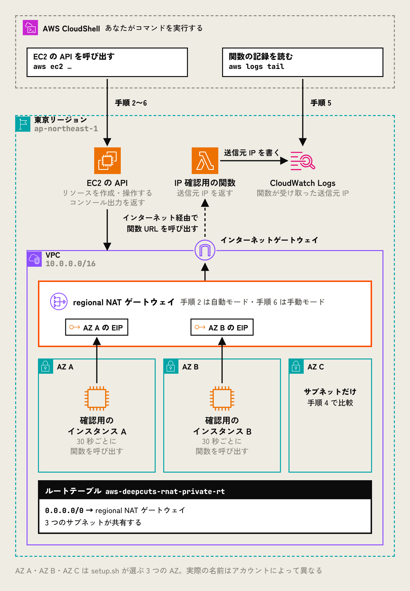
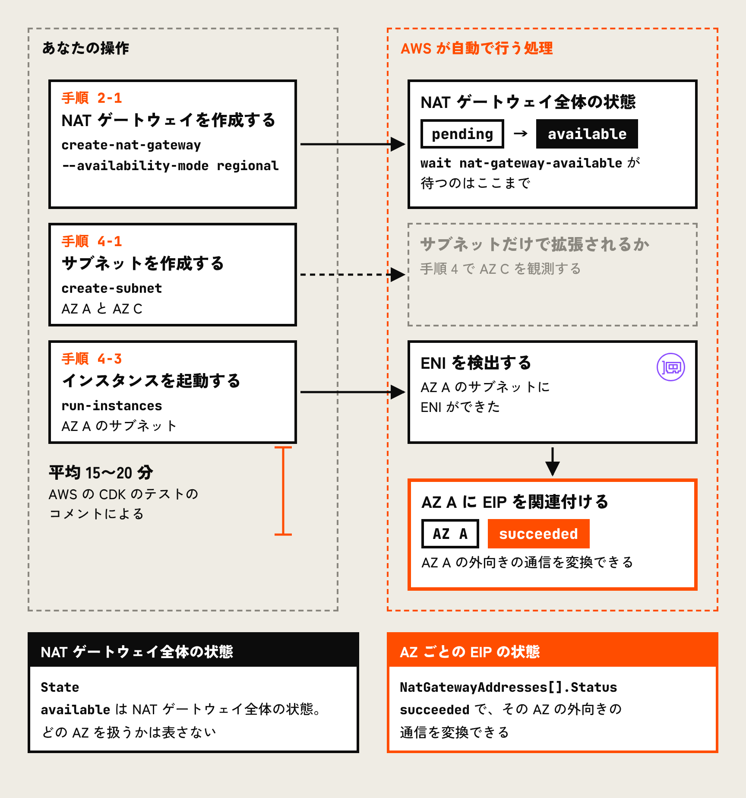
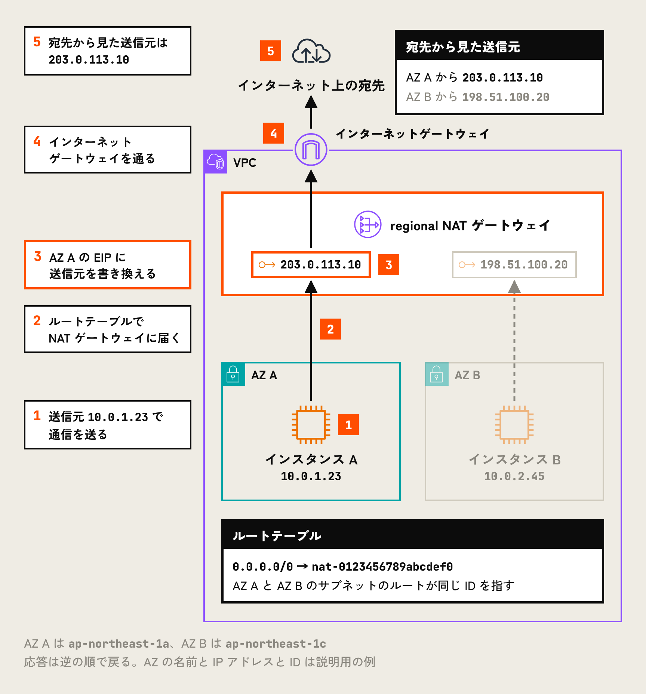
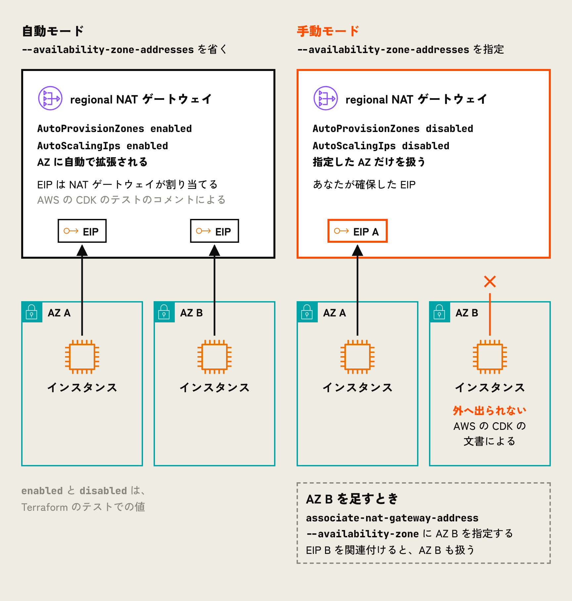

このリポジトリは AWS Deep Cuts の、Regional NAT Gateway に関するハンズオンコンテンツです。

<!-- TODO: 記事の公開後に、次の行のリンクを有効にする -->
<!-- Regional NAT Gateway の解説記事(Qiita)は[こちら]() -->

解説記事の原稿は [article/aws-regional-nat-gateway.md](./article/aws-regional-nat-gateway.md) にあります。

> **Note**: Regional NAT Gateway は、NAT ゲートウェイの設定である availability mode に加わった値 `regional` のことです。AWS CLI の変更履歴によると、この値を指定する引数は、2025 年 11 月 19 日に AWS CLI に加わりました。availability mode を `regional` にした NAT ゲートウェイは、VPC の複数の AZ（アベイラビリティーゾーン）にまたがって動きます。このハンズオンは、ブラウザから AWS CLI のコマンドを実行できる AWS CloudShell を使って、東京リージョン（`ap-northeast-1`）で実施します。
> - AWS の価格表である AWS Price List では、東京リージョンにも regional NAT ゲートウェイの単価が設定されています。ただし、公式の提供リージョンの一覧は、筆者は確かめられていません。東京リージョンで作成できない場合の対処は、[トラブルシューティング](#トラブルシューティング)にあります。<!-- 要確認: ユーザーガイドか What's New で、東京リージョンで提供されていることを確かめる -->
> - AWS CLI は、`--availability-mode` に対応した v2.32.0 以降が必要です。CloudShell の AWS CLI は最新版とは限らないため、[前提条件](#前提条件)の手順でバージョンを確認してください。
> - このハンズオンの一部の手順は、公式の説明が分かれている点や、説明が見つからない点を、あなたのアカウントで観測する手順です。結果は、実行した時期やリージョンによって異なる可能性があります。

> ⚠️ **コストに関する注意**
>
> NAT ゲートウェイには、存在している間の時間料金と、通過したデータの量に応じたデータ処理料金がかかります。AWS Price List の東京リージョンの単価は、regional NAT ゲートウェイの時間料金が 1 時間 $0.062、データ処理料金が 1 GB あたり $0.062 です。ただし、regional NAT ゲートウェイの時間料金に、扱っている AZ の数を掛けるかどうかは、AWS Price List からは分かりません。そこで、この見積もりでは、上限を求めるために、時間料金に扱う AZ の数を掛けて計算しています。時間料金の数え方は、手順 8 で、翌日以降に請求の記録から確かめます。<!-- 要確認: 料金ページで、regional NAT ゲートウェイの時間料金の数え方を確かめる -->
>
> EIP（Elastic IP アドレス）1 個には、1 時間 $0.005 のパブリック IPv4 アドレスの料金がかかります。確認用のインスタンスは、起動から 180 分で自動で終了します。
>
> | 放置期間 | 概算コストの上限 |
> | --- | --- |
> | ハンズオンの間の最大 4 時間 | 約 **$1.3**（約 210 円） |
> | 1日 | 約 **$5.3**（約 850 円） |
> | 1週間 | 約 **$34**（約 5,500 円） |
>
> この金額は、次の 5 つの条件で計算し、1 ドル 160 円で換算しています。内訳は [費用の見積もり](#費用の見積もり) にあります。
>
> - NAT ゲートウェイは 2 つ作成しますが、同時に存在するのは 1 つだけです。2 つが存在する時間は、合計 4 時間以内とします。2 つの存在時間をそれぞれ 1 時間単位に切り上げても、合計は 5 時間を超えないため、5 時間分で計算します。
> - 時間料金には、扱う AZ の数を掛けます。上限を求めるため、5 時間のすべてで 3 つの AZ を扱うものとします。
> - パブリック IPv4 アドレスは、自動モードの NAT ゲートウェイが割り当てる EIP 3 個と、手順 6 であなたが確保する EIP 2 個の計 5 個が、時間料金と同じ 5 時間分存在するものとします。自動モードの EIP に料金がかかるかどうかは確かめられていないため、かかるものとして計算しています。
> - NAT ゲートウェイを通る通信は、確認用のインスタンスが 30 秒ごとに送る小さな HTTPS の通信だけです。見積もりでは 1 GB とします。
> - 無料利用枠とクレジットは考えていません。
>
> このハンズオンでは、サブネットだけを置く比較用の AZ C を使います。この AZ C の分で、上限は約 $0.34 増えています。手順 4 と手順 5 の 2 つの観測を両立させるための費用です。
>
> 1 日と 1 週間の上限は、手順 5 まで進めてから後片付けを忘れた場合の額です。このとき残るのは、3 つの AZ を扱う自動モードの NAT ゲートウェイと、自動モードで割り当てられた EIP 3 個で、1 時間あたり最大 $0.201 かかります。1 日の上限は、手順どおりに進めた場合の上限の約 $1.32 に、残りの 20 時間分の $0.201 × 20 を足した額です。1 週間の上限も、同じように計算しています。途中でやめる場合も、必ず[手順 7 の cleanup.sh](#７後片付け) を実行してください。
>
> **検証が終わったら速やかに後片付けを実施してください。**

# AWS Deep Cutsとは
AWS Deep Cutsは、AWS の最新のサービスやニッチな機能、または高度にアカデミックな知識を要求するサービスなど、多くの人が知らない 『隠れた名曲 = **Deep Cuts**』 を深くまで掘り下げる技術シリーズです。

このようなサービスはWeb情報も少なく、初学者は気軽にキャッチアップできないのが実情です。

そこで AWS Deep Cuts シリーズでは、**前提知識も含めた分かりやすいサービス解説** と **手順通りに進めれば誰でも再現できるハンズオン** を提供します！

# ハンズオンのゴール

このハンズオンでは、パブリックサブネットが 1 つも無い VPC に、regional NAT ゲートウェイを作成します。そして、3 つの AZ のプライベートサブネットと、そこで起動した確認用のインスタンスから、NAT ゲートウェイが AZ ごとにどう動くかを観測します。

regional NAT ゲートウェイには、2 つの作り方があります。EIP を指定せずに作成し、NAT ゲートウェイが AZ に自動で拡張される作り方を自動モード、AZ と EIP を自分で指定する作り方を手動モードと呼びます。どちらも AWS の API の用語ではなく、Terraform と AWS の CDK の文書で使われている呼び名です。用語の意味と仕組みは、解説記事の「Regional NAT Gatewayとは？」と「仕組み」で説明しています。

AWS CLI のコマンドを 1 つずつ実行しながら、regional NAT ゲートウェイの次の 7 つの特徴を自分の目で確かめます。

| 確かめる特徴 | 手順 |
| --- | --- |
| regional NAT ゲートウェイは、サブネットではなく VPC を指定して作成でき、パブリックサブネットの無い VPC でも動く | 1・2・4 |
| どの AZ のプライベートサブネットも、同じ NAT ゲートウェイの ID にルートを向ける | 3・4 |
| 自動モードの NAT ゲートウェイは、時間をかけて AZ に拡張される。サブネットだけの AZ と比べて何をきっかけに拡張されるかと、どのくらいの時間がかかるかを測る | 4・5 |
| 拡張が終わるまでの間、その AZ のインスタンスの通信がどう扱われるかを観測する | 5 |
| AZ ごとに別の EIP で外へ出る | 5 |
| 手動モードでは、指定した AZ だけを扱い、送信元 IP を自分の EIP にできる | 6 |
| 1 時間の料金がどう数えられたかを、翌日以降に請求で確かめる | 8 |

所要時間の目安は、待ち時間を含めて 2〜3 時間です。拡張を待つ間に、記事の「仕組み」を読んでおくと、各手順で何を確かめているのかが分かりやすくなります。

# ハンズオン手順

以降の手順は、ハンズオン用に用意した AWS アカウントで実施してください。

## 構築するアーキテクチャ



- あなたは CloudShell から `aws ec2` のコマンドで EC2 の API を呼び出し、NAT ゲートウェイ・サブネット・ルート・インスタンス・EIP を操作します。
- 確認用のインスタンスは、AZ A と AZ B のプライベートサブネットから 30 秒ごとに IP 確認用の関数を呼び出し、結果をコンソール出力に書きます。AZ C のサブネットには、インスタンスを起動しません。
- あなたは `aws ec2 get-console-output` で、EC2 の API から確認の記録を読みます。インスタンスへ直接接続するのではありません。確認用のインスタンスには、インターネットからインスタンスへ向かう通信の経路がありません。また、あなたは `aws logs tail` で、IP 確認用の関数が受け取った送信元 IP を読みます。
- IP 確認用の関数は、呼び出し元の送信元 IP を返す Lambda 関数です。VPC の外にあり、インターネットから呼び出せる関数 URL を持ちます。AWS の CDK のテストも、同じ方法で regional NAT ゲートウェイの送信元 IP を確かめています。関数は、`setup.sh` が作成したトークンを URL に付けた呼び出しにだけ、送信元 IP を返します。
- IP 確認用の関数がログを書くための IAM ロール `aws-deepcuts-rnat-echo-role` も、`setup.sh` が作成します。このロールは図には描いていません。

AZ A・AZ B・AZ C は、`setup.sh` が選ぶ 3 つの AZ です。AZ A と AZ B にはサブネットと確認用のインスタンスを置き、AZ C にはサブネットだけを置きます。実際の AZ の名前は、アカウントによって異なります。

## 前提条件

- AWS CloudShell を **東京リージョン** で開くこと
- AWS CLI が v2.32.0 以降であること。次のコマンドで確認します。2 つ目のコマンドは、`create-nat-gateway` のパラメータの一覧を表示するだけで、AWS には何も送りません。

  ```bash
  aws --version
  aws ec2 create-nat-gateway --generate-cli-skeleton input | grep -E 'AvailabilityMode|AvailabilityZoneAddresses'
  ```

  2 つ目のコマンドで `"AvailabilityMode"` と `"AvailabilityZoneAddresses"` の 2 行が表示されない場合は、AWS CLI が古いため、次の手順で更新してください。

  <details>
  <summary>AWS CLI の最新版をホームディレクトリにインストールする手順</summary>

  CloudShell の AWS CLI は、最新版より数バージョン古いことがあります。CloudShell のホームディレクトリは次回以降のセッションでも残るため、ここに最新版をインストールします。

  ```bash
  curl -sS https://awscli.amazonaws.com/awscli-exe-linux-x86_64.zip -o /tmp/awscliv2.zip
  unzip -q -o /tmp/awscliv2.zip -d /tmp
  /tmp/aws/install --install-dir "$HOME/.local/aws-cli" --bin-dir "$HOME/.local/bin" --update
  export PATH="$HOME/.local/bin:$PATH"
  aws --version
  ```

  `export PATH=...` の行は、CloudShell のタブを新しく開くたびに実行してください。
  </details>

- 有料プランのアカウントであること。このハンズオンは、有料プランのアカウントを想定しています。<!-- 要確認: 無料プランのアカウントで NAT ゲートウェイを作成できるか -->
- 3 つ以上の AZ があるリージョンであること。東京リージョンは該当します。
- 手順 6 で、EIP を 2 つ確保できること。使っていない EIP が多いアカウントでは、EIP の数のクォータに達していることがあります。<!-- 要確認: 東京リージョンの EIP の既定のクォータ。自動モードの NAT ゲートウェイが割り当てる EIP が、このクォータに数えられるか -->
- 手順 8 を行う場合は、ハンズオンの前に次の 2 つを済ませておくこと。手順 8 は任意です。
  - Cost Explorer を一度も開いたことが無いアカウントでは、請求とコスト管理のコンソールで Cost Explorer を開いて有効にします。有効にしてからデータが表示されるまで時間がかかるため、ハンズオンの前に済ませておきます。<!-- 要確認: 有効化の手順の画面の名前と、データが表示されるまでの時間 -->
  - IAM ユーザーで Cost Explorer を使う場合は、ルートユーザーで「IAM ユーザーおよびロールによる請求情報へのアクセス」を有効にし、そのユーザーに Cost Explorer を読む権限を与えます。<!-- 要確認: アカウントの設定の画面の項目名 -->
- CloudShell を開いた IAM ユーザーまたは IAM ロールに、EC2・SSM・Lambda・IAM・CloudWatch Logs の操作権限があること。`AdministratorAccess` 相当の権限で実施するのが簡単です。

<details>
<summary>最小権限に近い IAM ポリシーの例</summary>

CloudShell を使う権限は、このポリシーとは別に必要です。たとえば AWS 管理ポリシーの `AWSCloudShellFullAccess` をアタッチします。ポリシーの中の `ConsoleRead` のステートメントは、手順の中でマネジメントコンソールの画面を確認するための読み取りの権限です。`CostExplorer` のステートメントは、手順 8 で Cost Explorer の API を使う場合だけ必要です。

```json
{
  "Version": "2012-10-17",
  "Statement": [
    {
      "Sid": "Ec2AndVpc",
      "Effect": "Allow",
      "Action": [
        "ec2:CreateVpc", "ec2:DeleteVpc", "ec2:DescribeVpcs",
        "ec2:CreateInternetGateway", "ec2:AttachInternetGateway", "ec2:DetachInternetGateway",
        "ec2:DeleteInternetGateway", "ec2:DescribeInternetGateways",
        "ec2:CreateSubnet", "ec2:DeleteSubnet", "ec2:DescribeSubnets",
        "ec2:CreateRouteTable", "ec2:AssociateRouteTable", "ec2:DeleteRouteTable", "ec2:DescribeRouteTables",
        "ec2:CreateRoute", "ec2:ReplaceRoute", "ec2:DeleteRoute",
        "ec2:CreateSecurityGroup", "ec2:DeleteSecurityGroup", "ec2:DescribeSecurityGroups",
        "ec2:CreateNatGateway", "ec2:DeleteNatGateway", "ec2:DescribeNatGateways",
        "ec2:AllocateAddress", "ec2:ReleaseAddress", "ec2:DescribeAddresses",
        "ec2:AssociateNatGatewayAddress", "ec2:DisassociateNatGatewayAddress",
        "ec2:RunInstances", "ec2:TerminateInstances", "ec2:DescribeInstances", "ec2:GetConsoleOutput",
        "ec2:DescribeAvailabilityZones", "ec2:DescribeInstanceTypeOfferings", "ec2:DescribeInstanceTypes",
        "ec2:DescribeNetworkInterfaces", "ec2:CreateTags"
      ],
      "Resource": "*"
    },
    {
      "Sid": "AmiParameter",
      "Effect": "Allow",
      "Action": "ssm:GetParameters",
      "Resource": "arn:aws:ssm:*::parameter/aws/service/ami-amazon-linux-latest/*"
    },
    {
      "Sid": "EchoFunction",
      "Effect": "Allow",
      "Action": [
        "lambda:CreateFunction", "lambda:DeleteFunction", "lambda:GetFunction",
        "lambda:CreateFunctionUrlConfig", "lambda:DeleteFunctionUrlConfig", "lambda:AddPermission"
      ],
      "Resource": "arn:aws:lambda:*:*:function:aws-deepcuts-rnat-echo"
    },
    {
      "Sid": "EchoRole",
      "Effect": "Allow",
      "Action": [
        "iam:CreateRole", "iam:GetRole", "iam:PutRolePolicy", "iam:DeleteRolePolicy",
        "iam:DeleteRole", "iam:PassRole", "iam:TagRole"
      ],
      "Resource": "arn:aws:iam::*:role/aws-deepcuts-rnat-echo-role"
    },
    {
      "Sid": "Logs",
      "Effect": "Allow",
      "Action": [
        "logs:CreateLogGroup", "logs:PutRetentionPolicy", "logs:DeleteLogGroup",
        "logs:DescribeLogGroups", "logs:FilterLogEvents", "logs:TagResource"
      ],
      "Resource": "*"
    },
    {
      "Sid": "CostExplorer",
      "Effect": "Allow",
      "Action": "ce:GetCostAndUsage",
      "Resource": "*"
    },
    {
      "Sid": "ConsoleRead",
      "Effect": "Allow",
      "Action": [
        "ec2:Describe*", "lambda:ListFunctions", "lambda:GetFunctionUrlConfig",
        "logs:DescribeLogStreams", "logs:GetLogEvents"
      ],
      "Resource": "*"
    }
  ]
}
```

サービス認可リファレンスによると、`ec2:CreateNatGateway` の対象のリソースの種類は、`elastic-ip`・`natgateway`・`subnet`・`vpc` です。このポリシーの例では、`Resource` を `*` にしています。
</details>

以降、各種コマンドは、東京リージョンで開いた[CloudShell](https://docs.aws.amazon.com/cloudshell/latest/userguide/welcome.html)で実行してください。

## ハンズオンの進め方

このハンズオンの手順 2〜8 は、実験の形で進めます。あなたは、各手順の前に、何が起きるかの予想を書きます。そのうえでコマンドを実行し、結果と時刻を記録します。記録には、次の 2 つの観測記録表を使います。2 つの表を、メモ帳などに写してから進めてください。時刻は、すべて UTC です。

表の中の `nat_status` は、NAT ゲートウェイの AZ ごとの EIP と状態を表示する関数で、手順 4-4 で定義します。

**表 1 時刻の記録**

| 手順 | できごと | UTC の時刻 |
| --- | --- | --- |
| 2-1 | 自動モードの NAT ゲートウェイの作成を依頼した | |
| 2-2 | 自動モードの NAT ゲートウェイが `available` になった | |
| 4-1 | サブネット A・C を作成した | |
| 4-3 | インスタンス A を起動した。この 180 分後の終了予定も書く | |
| 4-4 | 自動モードの `nat_status` に AZ A が `succeeded` で初めて表示された | |
| 4-4 | 自動モードの `nat_status` に AZ C が `succeeded` で初めて表示された。表示されなければ「なし」と書く | |
| 5-1 | サブネット B を作成し、インスタンス B を起動した。この 180 分後の終了予定も書く | |
| 5-2 | 自動モードの `nat_status` に AZ B が `succeeded` で初めて表示された | |
| 6-1 | 自動モードの NAT ゲートウェイの削除を依頼した ／ `deleted` になった | |
| 6-2 | 手動モードの NAT ゲートウェイの作成を依頼した ／ `available` になった ／ AZ A が `succeeded` で表示された | |
| 6-5 | AZ B に EIP B を関連付けた ／ AZ B が `succeeded` で表示された | |
| 7 | cleanup.sh が手動モードの NAT ゲートウェイの削除を依頼した ／ `deleted` になった。どちらも cleanup.sh が表示する | |

表 1 の時刻は、各操作の直後に実行する `date -u +%H:%M:%S` の表示か、観測のループが表示する `── HH:MM:SS UTC` の行から写します。表 1 は手順 8 の計算に使うため、すべての行を埋めてください。削除した NAT ゲートウェイは、削除からしばらくすると `describe-nat-gateways` に表示されなくなります。そのため、時刻は後から調べ直さずに、その場で書いてください。<!-- 要確認: 削除した NAT ゲートウェイが describe-nat-gateways に表示されなくなるまでの時間。一般には約 1 時間 -->

**表 2 予想と結果**

| 手順 | 観測すること | 予想 | 結果 |
| --- | --- | --- | --- |
| 2 | `available` になった直後の `NatGatewayAddresses` | | |
| 4 | インスタンス A の確認の記録に、初めて IP アドレスが表示された時刻と、その IP アドレス | | |
| 4 | サブネットだけの AZ C が、`NatGatewayAddresses` に現れたか | | |
| 5 | AZ B に拡張されるまでの間の、インスタンス B の確認の記録。`FAIL`・EIP A・その他のどれか | | |
| 5 | インスタンス B の確認の記録に、AZ B の EIP が初めて表示された時刻 | | |
| 5-4 | 任意。NAT ゲートウェイの ENI の `SubnetId` と `InterfaceType` | | |
| 5-4 | 任意。`RouteTableId` に値があるか。`describe-route-tables` で中身が見えるか。見えるなら、インターネットゲートウェイへのルートがあるか | | |
| 5-5 | 自動モードの NAT ゲートウェイが動いている間に、`nat_status` の EIP が `describe-addresses` に表示されるか。表示されるなら `ServiceManaged` の値 | | |
| 6-1 | 自動モードの NAT ゲートウェイを削除した後に、同じ EIP が `describe-addresses` に表示されるか。表示されるなら `ServiceManaged` の値 | | |
| 6-4 | 手動モードで AZ A だけを指定したときの、インスタンス A と B の確認の記録 | | |
| 6-5 | AZ B に EIP B を追加した後、インスタンス B の確認の記録が EIP B になった時刻 | | |
| 8 | Cost Explorer の `APN1-RegionalNatGateway-Hours` の使用量。NAT ゲートウェイごとの予測値と、AZ ごとの予測値は手順 8 で計算する | | |

どの手順でやめる場合も、[手順 7 の cleanup.sh](#７後片付け) を実行してください。`cleanup.sh` は、どこまで進めたかに関係なく、このハンズオンのタグと VPC でリソースを探して削除します。

## １．事前準備

VPC やインターネットゲートウェイの作成は、このハンズオンの本質ではないため、`setup.sh` で作成します。`setup.sh` は、サブネットと NAT ゲートウェイを作成しません。これらは手順 2 以降で、あなたが 1 つずつ作成します。

```bash
# このリポジトリをクローン
git clone https://github.com/AWS-Deep-Cuts/aws-regional-nat-gateway
cd aws-regional-nat-gateway/hands-on

# セットアップスクリプトの実行
bash ./setup.sh

# 以下の文言が表示されればセットアップ成功です
# ✅ セットアップが完了しました！
```

`setup.sh` は、次のリソースを作成します。Lambda 関数と関数 URL を除くどのリソースにも、タグ `Project` の値 `aws-deepcuts-rnat` を付けます。

| リソース | 名前 | 用途 |
| --- | --- | --- |
| VPC | `aws-deepcuts-rnat-vpc` | CIDR ブロックは `10.0.0.0/16`。サブネットは、手順 4 と手順 5 であなたが作成する |
| インターネットゲートウェイ | `aws-deepcuts-rnat-igw` | VPC に取り付ける |
| ルートテーブル | `aws-deepcuts-rnat-private-rt` | 3 つのプライベートサブネットで共有する。ルートとサブネットの関連付けは、手順 3〜6 であなたが追加する |
| セキュリティグループ | `aws-deepcuts-rnat-check-sg` | 確認用のインスタンスに付ける。インバウンドのルールは無い |
| IAM ロール | `aws-deepcuts-rnat-echo-role` | IP 確認用の関数がログを書くために使う |
| Lambda 関数と関数 URL | `aws-deepcuts-rnat-echo` | IP 確認用の関数。呼び出し元の送信元 IP を返す |
| ロググループ | `/aws/lambda/aws-deepcuts-rnat-echo` | IP 確認用の関数のログを保存する。保持期間は 1 日 |

`setup.sh` は、VPC にインターネットゲートウェイを取り付けますが、パブリックサブネットは作成しません。AWS の CDK と Terraform の regional NAT ゲートウェイの例とテストも、パブリックサブネットの無い VPC に、インターネットゲートウェイを先に取り付けています。このハンズオンも、その構成に合わせています。

`setup.sh` は、このほかに、確認用のインスタンスのユーザーデータ `egress-check.sh` を `hands-on` ディレクトリに作成します。ユーザーデータは、インスタンスの初回の起動時に実行されるスクリプトです。中身は手順 4-2 で確認します。

`setup.sh` は、作成したリソースの ID と、選んだ AZ の名前を `resource-ids.env` に保存しました。次のコマンドでこのファイルを読み込むと、以降のコマンドで変数として使えます。

```bash
source ./resource-ids.env
cat resource-ids.env
```

| 変数 | 中身 | 使う手順 |
| --- | --- | --- |
| `REGION` | リージョン `ap-northeast-1` | すべて |
| `VPC_ID` | VPC の ID | 2・4・6 |
| `RT_ID` | プライベートサブネット用のルートテーブルの ID | 3・4・6 |
| `SG_ID` | 確認用のインスタンスのセキュリティグループの ID。インバウンドのルールは無い | 4・5 |
| `AZ_A`・`AZ_B`・`AZ_C` | `setup.sh` が選んだ 3 つの AZ の名前。AZ A と AZ B は t4g.nano を起動できる AZ、AZ C はサブネットだけを置く AZ | 4・5・6 |
| `AMI_ID`・`INSTANCE_TYPE` | Amazon Linux 2023 の arm64 の AMI の ID と、インスタンスタイプ `t4g.nano` | 4・5 |
| `ECHO_URL`・`ECHO_TOKEN` | IP 確認用の関数の URL と、呼び出しに付けるトークン | 1 |
| `ECHO_LOG_GROUP` | IP 確認用の関数のロググループの名前 | 5 |

`cat` の出力には、この表に無い `ACCOUNT_ID`・`PROJECT`・`IGW_ID`・`AZ_A_ID`・`AZ_B_ID`・`AZ_C_ID`・`ECHO_FUNCTION`・`ECHO_ROLE` も表示されます。`AZ_A_ID` などは、AZ の名前に対応する AZ ID です。これらの変数は、以降の手順のコマンドでは使いません。`cleanup.sh` が、残ったリソースを探すときに使います。

以降の手順でも、作成したリソースの ID を、このファイルに追記していきます。

> **Note**: CloudShell は、操作しない時間が続くとセッションが終了し、変数が消えます。その場合は、次の 2 行を実行してから続きの手順に進んでください。
>
> ```bash
> cd ~/aws-regional-nat-gateway/hands-on
> source ./resource-ids.env
> ```
>
> 前提条件で AWS CLI をホームディレクトリにインストールした場合は、`export PATH="$HOME/.local/bin:$PATH"` も実行します。手順 4-4 以降では、観測に使う 2 つの関数 `nat_status` と `check_log` も、手順 4-4 のコマンドで定義し直してください。

### 1-1. 事前準備の結果を確かめて IP 確認用の関数を試す

この手順では、パブリックサブネットの無い VPC ができたことと、IP 確認用の関数が送信元 IP を返すことを確かめます。

IP 確認用の関数の URL は、認証なしでインターネットに公開されます。関数 URL の認証の設定である `AuthType` が `NONE` だからです。AWS は、AWS のサービスの使い方をまとめ、AI エージェントが読み込んで使えるようにした文書を、Agent Skill として公開しています。サーバーレスの Agent Skill は、`NONE` を使うときは、関数のコードの中の認証と組み合わせるよう書いています。そこで、このハンズオンの関数は、`setup.sh` が作成した乱数の文字列であるトークンが URL に付いた呼び出しだけに、送信元 IP を返します。それ以外の呼び出しには HTTP のステータスコード 403 と本文 `invalid token` を返し、送信元 IP を返しません。このとき、関数のコードはログに何も書きません。Lambda が書く、関数の実行の開始と終了を表す行は残ります。URL を知った第三者が呼び出しても、送信元 IP は返りません。関数は、手順 7 の `cleanup.sh` で削除します。

次の 2 つのコマンドで、関数を呼び出します。

```bash
curl -s "${ECHO_URL}?token=${ECHO_TOKEN}&az=cloudshell"; echo
curl -s -o /dev/null -w "%{http_code}\n" "${ECHO_URL}?az=no-token"
```

1 つ目のコマンドは、トークンを付けて関数を呼び出し、関数が返した IPv4 アドレスを 1 行で表示します。2 つ目のコマンドは、トークンを付けずに関数を呼び出し、HTTP のステータスコードを表示します。

出力の形の例は次のとおりです。IP アドレスは説明用の例です。

```text
192.0.2.100
403
```

<!-- 画面写真: VPC コンソールの aws-deepcuts-rnat-vpc の「リソースマップ」タブ。サブネットが 0 個であることと、インターネットゲートウェイを枠で囲む -->
<!-- 要確認: VPC コンソールの「リソースマップ」タブの名前 -->

> **この手順で確かめること**
> - **やること**: VPC コンソールの左のメニューの「お使いの VPC」で `aws-deepcuts-rnat-vpc` を開き、リソースマップを確認します。左のメニューの「ルートテーブル」で `aws-deepcuts-rnat-private-rt` を開き、「ルート」タブも確認します。CloudShell で、上の 2 つの `curl` を実行します。
> - **期待する結果**: VPC には、インターネットゲートウェイが取り付けられていて、サブネットは 1 つもありません。ルートテーブル `aws-deepcuts-rnat-private-rt` には、VPC の中の通信のルートである `10.0.0.0/16` だけがあります。1 つ目の `curl` は IPv4 アドレスを 1 行、2 つ目の `curl` は `403` を表示します。
> - **ここから分かること**: この VPC には、パブリックサブネットがありません。手順 2 では、この VPC に NAT ゲートウェイを作成します。1 つ目の `curl` が表示したのは、IP 確認用の関数から見た CloudShell の送信元 IP です。手順 4 以降では、同じ関数を確認用のインスタンスから呼び出し、NAT ゲートウェイを通った通信の送信元 IP を確かめます。トークンの無い呼び出しには、関数は送信元 IP を返しません。

## ２．regional NAT ゲートウェイを作成する

従来の NAT ゲートウェイは、パブリックサブネットを指定して作成しました。EC2 の API の説明によると、availability mode を `regional` にした NAT ゲートウェイは、サブネットではなく VPC を指定して作成します。この手順では、AZ と EIP の組み合わせを指定する `--availability-zone-addresses` を指定せずに作成します。EC2 の API の説明によると、この指定を省くと、NAT ゲートウェイは ENI を検出した AZ に自動で拡張し、その AZ に EIP を関連付けます。この作り方を自動モードと呼びます。ENI（Elastic Network Interface）は、EC2 インスタンスなどを VPC につなぐときに、サブネットの中に作成される仮想的なネットワークインターフェイスです。

### 2-0. コンソールで availability mode の選択肢を見る

作成の前に、マネジメントコンソールの作成の画面で、availability mode の選択肢を確認します。この画面では作成しません。

1. VPC コンソールの左のメニューから「NAT ゲートウェイ」を選び、「NAT ゲートウェイを作成」を押します。
2. availability mode の選択肢として、ゾーンとリージョンに当たる 2 つの選択肢があるかを確認します。
3. リージョンに当たる選択肢を選び、サブネットを選ぶ欄が、VPC を選ぶ欄に変わるかを確認します。
4. EIP の割り当て方の欄があれば、自動と手動に当たる選択肢も確認します。
5. 最後に「キャンセル」を押します。

この画面の欄は、次の 2-1 で使う AWS CLI のパラメータに、次のように対応します。

| 画面の欄 | AWS CLI のパラメータ |
| --- | --- |
| ゾーンかリージョンかを選ぶ欄 <!-- 要確認: 画面の項目名 --> | `--availability-mode` |
| リージョンを選んだときに表示される、VPC を選ぶ欄 <!-- 要確認: 画面の項目名 --> | `--vpc-id` |
| EIP を自動で割り当てるか、AZ ごとに指定するかを選ぶ欄 <!-- 要確認: 画面の項目名と、この欄があるか --> | `--availability-zone-addresses` を省くか、指定するか |

作成は、次の 2-1 で AWS CLI から行います。CLI で作成すると、作成を依頼した時刻を記録しやすく、手順 4 以降で同じ NAT ゲートウェイの ID を変数で使えるためです。

<!-- 画面写真: VPC コンソールの「NAT ゲートウェイを作成」の画面。availability mode の選択肢と、リージョンを選んだときの VPC の欄を枠で囲む -->
<!-- 要確認: 画面の項目名と、regional を選んだときの欄の変化。画面に availability mode の選択肢が無い場合は、2-0 を削り、記事の対応の 1 文も削る -->

### 2-1. 作成を依頼する

`create-nat-gateway` で、EC2 に NAT ゲートウェイの作成を依頼します。

```bash
NAT_ID=$(aws ec2 create-nat-gateway \
  --region "${REGION}" \
  --availability-mode regional \
  --vpc-id "${VPC_ID}" \
  --tag-specifications 'ResourceType=natgateway,Tags=[{Key=Name,Value=aws-deepcuts-rnat-auto},{Key=Project,Value=aws-deepcuts-rnat}]' \
  --query NatGateway.NatGatewayId --output text)

[[ -n "${NAT_ID}" ]] && echo "NAT_ID=\"${NAT_ID}\"" >> resource-ids.env
echo "${NAT_ID}"
date -u +%H:%M:%S
```

表示された時刻を、観測記録表の表 1 の「2-1」の行に書きます。コマンドが失敗した場合、`NAT_ID` は空になり、`resource-ids.env` には何も追記されません。

| パラメータ | 指定した値 | 意味 |
| --- | --- | --- |
| `--availability-mode` | `regional` | 複数の AZ にまたがって動く NAT ゲートウェイを作成する。省略すると `zonal` になり、1 つの AZ で動く NAT ゲートウェイを作成する |
| `--vpc-id` | 事前準備の VPC | `regional` では、サブネットではなく VPC を指定する |
| `--tag-specifications` | 名前とプロジェクトのタグ | コンソールで見分けるため。`cleanup.sh` も、このタグで NAT ゲートウェイを探す |

`--subnet-id` と `--allocation-id` は指定しません。Terraform の文書は、`regional` ではこの 2 つを指定してはならないと書いています。`--availability-zone-addresses` を指定しないため、この NAT ゲートウェイは自動モードになります。

EC2 は NAT ゲートウェイの作成を始め、NAT ゲートウェイ全体の状態は `pending` から始まります。`create-nat-gateway` は、作成の完了を待たずに終わります。

### 2-2. `available` になるのを待つ

```bash
time aws ec2 wait nat-gateway-available --nat-gateway-ids "${NAT_ID}" --region "${REGION}"
date -u +%H:%M:%S
```

`aws ec2 wait` コマンドは、状態が変わるまで、CLI が API を繰り返し呼び出して待つ機能です。この機能を waiter と呼びます。`aws ec2 wait nat-gateway-available` は、NAT ゲートウェイ全体の状態が `available` になるまで、15 秒おきに最大 10 分待ちます。`Waiter NatGatewayAvailable failed: Max attempts exceeded` と表示された場合は、同じコマンドをもう一度実行してください。表示された時刻を、観測記録表の表 1 の「2-2」の行に書きます。

`available` になったら、NAT ゲートウェイの詳細を確認します。

```bash
aws ec2 describe-nat-gateways --nat-gateway-ids "${NAT_ID}" --region "${REGION}" \
  --query 'NatGateways[0].{State:State,AvailabilityMode:AvailabilityMode,AutoProvisionZones:AutoProvisionZones,AutoScalingIps:AutoScalingIps,SubnetId:SubnetId,NatGatewayAddresses:NatGatewayAddresses}'
```

出力の形の例は次のとおりです。`NatGatewayAddresses` が空になるかどうかは、この手順で観測します。

```json
{
    "State": "available",
    "AvailabilityMode": "regional",
    "AutoProvisionZones": "enabled",
    "AutoScalingIps": "enabled",
    "SubnetId": null,
    "NatGatewayAddresses": []
}
```

| 項目 | 意味 |
| --- | --- |
| `State` | NAT ゲートウェイ全体の状態。`pending`・`failed`・`available`・`deleting`・`deleted` のどれか。EC2 の API の説明によると、`available` は NAT ゲートウェイを削除するまで続き、NAT ゲートウェイが健全であることは表さない |
| `AvailabilityMode` | `zonal` か `regional` か |
| `AutoProvisionZones` | EC2 の API の説明によると、`enabled` のとき、NAT ゲートウェイは VPC にサブネットがある AZ に EIP を関連付け、新しい AZ にサブネットを作成するとその AZ に拡張する。作成時に指定する引数は無く、応答にだけある項目 |
| `AutoScalingIps` | EC2 の API の説明によると、`enabled` のとき、ある AZ から 1 つの宛先への同時接続が増えて、NAT ゲートウェイが変換に使うポートが足りなくなると、AWS がその AZ に EIP を自動で追加する。応答にだけある項目 |
| `SubnetId` | zonal NAT ゲートウェイを作成したサブネット。この手順では指定していないため、値が無く `null` と表示されると考えられる<!-- 要確認 --> |
| `NatGatewayAddresses` | AZ ごとの EIP の一覧。要素ごとに、AZ の名前 `AvailabilityZone`、パブリック IP アドレス `PublicIp`、AZ ごとの EIP の状態 `Status` などが入る。`Status` は `assigning`・`unassigning`・`associating`・`disassociating`・`succeeded`・`failed` のどれか |

<!-- 画面写真: VPC コンソールの「NAT ゲートウェイ」の aws-deepcuts-rnat-auto の詳細。availability mode の表示と、EIP の一覧（まだ空の可能性がある）を枠で囲む -->
<!-- 要確認: regional の NAT ゲートウェイの詳細画面の項目名 -->

> **この手順で確かめること**
> - **やること**: `describe-nat-gateways` の出力の 6 つの項目を確認します。VPC コンソールの左のメニューの「NAT ゲートウェイ」で `aws-deepcuts-rnat-auto` を開きます。観測記録表の表 1 に作成を依頼した時刻と `available` になった時刻を、表 2 の「2」の行に `NatGatewayAddresses` の内容を書きます。
> - **期待する結果**: `State` は `available`、`AvailabilityMode` は `regional` です。Terraform のテストでは、自動モードで作成すると、`AutoProvisionZones` と `AutoScalingIps` はどちらも `enabled` になります。`NatGatewayAddresses` は、空であると予想できます。拡張のきっかけを ENI の検出とする説明でも、サブネットの作成とする説明でも、サブネットも ENI も無いこの VPC では、拡張される AZ が無いためです。<!-- 要確認: available の直後に NatGatewayAddresses が空か -->
> - **ここから分かること**: NAT ゲートウェイの状態は `available` ですが、まだどの AZ にも EIP がありません。`available` は NAT ゲートウェイ全体の状態で、どの AZ を扱っているかは表しません。`aws ec2 wait nat-gateway-available` も、この全体の状態だけを待ちます。AZ ごとの状態は、`NatGatewayAddresses` で確かめます。

## ３．ルートテーブルのルートを NAT ゲートウェイに向ける

zonal NAT ゲートウェイを AZ ごとに配置する構成では、AZ ごとのルートテーブルを、同じ AZ の NAT ゲートウェイに向けました。regional NAT ゲートウェイでは、どの AZ のサブネットのルートテーブルも、同じ NAT ゲートウェイの ID に向けます。このハンズオンでは、3 つの AZ のサブネットで 1 つのルートテーブルを共有します。

`create-route` で、ルートテーブル `aws-deepcuts-rnat-private-rt` に、すべての宛先を NAT ゲートウェイに送るルートを追加します。

```bash
aws ec2 create-route --region "${REGION}" \
  --route-table-id "${RT_ID}" \
  --destination-cidr-block 0.0.0.0/0 \
  --nat-gateway-id "${NAT_ID}"
```

出力の形の例は次のとおりです。

```json
{
    "Return": true
}
```

| パラメータ | 指定した値 | 意味 |
| --- | --- | --- |
| `--route-table-id` | 事前準備のルートテーブル | ルートを追加するルートテーブル |
| `--destination-cidr-block` | `0.0.0.0/0` | すべての宛先に当てはまるルート。デフォルトルートと呼ぶ |
| `--nat-gateway-id` | 手順 2 の NAT ゲートウェイ | 宛先に当てはまる通信の送り先 |

<!-- 画面写真: VPC コンソールの「ルートテーブル」の aws-deepcuts-rnat-private-rt の「ルート」タブ。0.0.0.0/0 とターゲットの nat-… を枠で囲む -->

> **この手順で確かめること**
> - **やること**: VPC コンソールの左のメニューの「ルートテーブル」で `aws-deepcuts-rnat-private-rt` を開き、「ルート」タブを確認します。
> - **期待する結果**: 送信先 `0.0.0.0/0` のターゲットが、`nat-` で始まる NAT ゲートウェイの ID です。状態は「アクティブ」です。API では、ルートの状態 `State` の `active` に当たります。
> - **ここから分かること**: ルートが指しているのは、AZ ではなく NAT ゲートウェイ 1 つです。このルートテーブルを関連付けたサブネットは、どの AZ にあっても、同じ NAT ゲートウェイへ通信を送ります。

## ４．サブネットだけの AZ とインスタンスのある AZ を比べる

自動モードの NAT ゲートウェイが新しい AZ に拡張されるきっかけについて、EC2 の API の説明は 2 通りに書いています。`CreateNatGateway` の説明は「ENI を検出したとき」、応答の項目 `AutoProvisionZones` の説明は「サブネットを作成したとき」です。この手順では、AZ A と AZ C にサブネットを作成し、AZ A にだけインスタンスを起動します。AZ A には、インスタンスの ENI ができます。AZ C には、サブネットだけがあります。どちらの AZ に、いつ拡張されるかを観測します。

AZ B には、この手順では何も作成しません。サブネットだけで拡張される場合、AZ B にもサブネットを作成すると、手順 5 でインスタンス B を起動する前に AZ B への拡張が終わってしまいます。そうなると、拡張が終わるまでの間の通信を、手順 5 で観測できなくなるためです。

自動モードで AZ に拡張されるまでに、あなたの操作と AWS が自動で行う処理は、次の図の順に進みます。AWS の CDK のテストのコメントによると、AWS の文書は、拡張に平均 15〜20 分かかると書いています。



### 4-1. AZ A と AZ C にプライベートサブネットを作成する

`create-subnet` で、AZ A と AZ C にサブネットを 1 つずつ作成します。

```bash
SUBNET_A=$(aws ec2 create-subnet --region "${REGION}" \
  --vpc-id "${VPC_ID}" --availability-zone "${AZ_A}" --cidr-block 10.0.1.0/24 \
  --tag-specifications 'ResourceType=subnet,Tags=[{Key=Name,Value=aws-deepcuts-rnat-private-a},{Key=Project,Value=aws-deepcuts-rnat}]' \
  --query Subnet.SubnetId --output text)
[[ -n "${SUBNET_A}" ]] && echo "SUBNET_A=\"${SUBNET_A}\"" >> resource-ids.env

SUBNET_C=$(aws ec2 create-subnet --region "${REGION}" \
  --vpc-id "${VPC_ID}" --availability-zone "${AZ_C}" --cidr-block 10.0.3.0/24 \
  --tag-specifications 'ResourceType=subnet,Tags=[{Key=Name,Value=aws-deepcuts-rnat-private-c},{Key=Project,Value=aws-deepcuts-rnat}]' \
  --query Subnet.SubnetId --output text)
[[ -n "${SUBNET_C}" ]] && echo "SUBNET_C=\"${SUBNET_C}\"" >> resource-ids.env
echo "${SUBNET_A} ${SUBNET_C}"
```

続けて、2 つのサブネットに、手順 3 でルートを追加したルートテーブルを関連付けます。

```bash
aws ec2 associate-route-table --region "${REGION}" --route-table-id "${RT_ID}" --subnet-id "${SUBNET_A}"
aws ec2 associate-route-table --region "${REGION}" --route-table-id "${RT_ID}" --subnet-id "${SUBNET_C}"
date -u +%H:%M:%S
```

表示された時刻を、観測記録表の表 1 の「4-1」の行に書きます。

| パラメータ | 指定した値 | 意味 |
| --- | --- | --- |
| `--availability-zone` | `AZ_A`・`AZ_C` | サブネットを作成する AZ |
| `--cidr-block` | `10.0.1.0/24`・`10.0.3.0/24` | サブネットの IP アドレスの範囲。手順 5 の AZ B のサブネットは `10.0.2.0/24` にする |
| `--route-table-id` | 事前準備のルートテーブル | サブネットに関連付けるルートテーブル。手順 3 で、デフォルトルートを NAT ゲートウェイに向けた |

作成したサブネットは、インターネットゲートウェイへのルートを持たないため、プライベートサブネットです。サブネットの設定 `MapPublicIpOnLaunch` は既定で無効のため、このサブネットで起動するインスタンスには、パブリック IP アドレスが付きません。<!-- 要確認: 新しく作成した VPC のサブネットの MapPublicIpOnLaunch の既定値 -->

AZ C のサブネットも、AZ A のサブネットと同じルートテーブルを使います。2 つの AZ の違いは、次の 4-3 で AZ A にだけインスタンスを起動し、ENI ができることだけです。

### 4-2. 確認用のインスタンスが行うことを確かめる

確認用のインスタンスは、`setup.sh` が作成したユーザーデータ `egress-check.sh` を、初回の起動時に実行します。中身を確認します。

```bash
cat egress-check.sh
```

このスクリプトには、IP 確認用の関数の URL とトークンが書き込まれています。そのため、`egress-check.sh` は Git の管理から外しています。スクリプトは次のことを行います。

| 順序 | 処理 |
| --- | --- |
| 1 | 起動から 180 分後に、OS をシャットダウンする予約をする |
| 2 | インスタンスメタデータから、インスタンスのある AZ の名前を取得する |
| 3 | 30 秒ごとに、トークンと、2 で取得した AZ の名前を `az=` として URL に付けて、IP 確認用の関数を呼び出す。応答を待つのは 5 秒まで |
| 4 | 呼び出すたびに、`[egress-check] <UTC の時刻> az=<AZ の名前> egress=<送信元 IP>` の 1 行をコンソール出力に書く。外へ出られなかったときは、送信元 IP の代わりに `FAIL` と書く |

コンソール出力は、インスタンスのシリアルコンソールに出力された文字です。あなたは EC2 の API の `GetConsoleOutput` で読みます。この 1 行を、この README では確認の記録と呼びます。

インスタンスは、4-3 で `--instance-initiated-shutdown-behavior terminate` を付けて起動します。そのため、OS がシャットダウンすると、インスタンスは終了します。後片付けを忘れても、インスタンスの料金は最大 3 時間で止まります。

インスタンスは起動から 180 分で終了します。4-3 で起動した時刻に 180 分を足した終了予定の時刻を、観測記録表の表 1 の「4-3」の行に書いておきます。手順 6 の途中で終了予定を過ぎそうな場合は、[トラブルシューティング](#トラブルシューティング)の「確認の記録が途中で止まる」の行を確認してください。

### 4-3. AZ A にインスタンスを起動する

`run-instances` で、AZ A のサブネットに確認用のインスタンス A を起動します。

```bash
INSTANCE_A=$(aws ec2 run-instances --region "${REGION}" \
  --image-id "${AMI_ID}" --instance-type "${INSTANCE_TYPE}" \
  --subnet-id "${SUBNET_A}" --security-group-ids "${SG_ID}" \
  --user-data file://egress-check.sh \
  --instance-initiated-shutdown-behavior terminate \
  --metadata-options HttpTokens=required \
  --tag-specifications 'ResourceType=instance,Tags=[{Key=Name,Value=aws-deepcuts-rnat-check-a},{Key=Project,Value=aws-deepcuts-rnat}]' \
  --query 'Instances[0].InstanceId' --output text)
[[ -n "${INSTANCE_A}" ]] && echo "INSTANCE_A=\"${INSTANCE_A}\"" >> resource-ids.env
echo "${INSTANCE_A}"
date -u +%H:%M:%S
```

このコマンドは 1 回だけ実行します。もう一度実行すると、インスタンスがもう 1 台起動します。表示された時刻と、その 180 分後の終了予定を、観測記録表の表 1 の「4-3」の行に書きます。

| パラメータ | 指定した値 | 意味 |
| --- | --- | --- |
| `--image-id` | Amazon Linux 2023 の AMI | インスタンスの OS |
| `--instance-type` | `t4g.nano` | インスタンスタイプ。Arm のプロセッサーを使う小さなインスタンス |
| `--subnet-id` | サブネット A | インスタンスを起動するサブネット。EC2 は、このサブネットに ENI を作成する |
| `--security-group-ids` | 事前準備のセキュリティグループ | インバウンドのルールは無く、外向きの通信だけを許可する |
| `--user-data` | `egress-check.sh` | 初回の起動時に実行するスクリプト。API では base64 に変換して渡す値だが、AWS CLI がファイルの中身を base64 に変換してから API に渡す |
| `--instance-initiated-shutdown-behavior` | `terminate` | OS からシャットダウンしたときに、インスタンスを停止ではなく終了する。既定は停止 |
| `--metadata-options` | `HttpTokens=required` | インスタンスメタデータの取得に、トークンを使う IMDSv2 を必須にする |

EC2 は、サブネット A に ENI を作成し、インスタンスを起動します。EC2 の API の説明によると、自動モードの NAT ゲートウェイは、ENI を検出すると、その AZ に拡張して EIP を関連付けます。

### 4-4. 観測する

観測に使う 2 つの関数を定義します。CloudShell のセッションが終了した場合は、このコマンドをもう一度実行してください。

```bash
nat_status() {   # NAT ゲートウェイの AZ ごとの EIP と状態を表示する
  aws ec2 describe-nat-gateways --nat-gateway-ids "$1" --region "${REGION}" \
    --query 'NatGateways[0].NatGatewayAddresses[].[AvailabilityZone,PublicIp,Status]' --output text
}
check_log() {    # 確認用のインスタンスの確認の記録を、新しいものから $2 行表示する。$2 を省くと 1 行
  aws ec2 get-console-output --instance-id "$1" --latest --region "${REGION}" \
    --query Output --output text | grep '\[egress-check\]' | tail -n "${2:-1}"
}
```

| 関数 | 呼び出す API | 表示するもの |
| --- | --- | --- |
| `nat_status <NAT ゲートウェイの ID>` | `DescribeNatGateways` | `NatGatewayAddresses` の 1 要素を 1 行にした、AZ の名前・EIP のパブリック IP アドレス・AZ ごとの EIP の状態 |
| `check_log <インスタンスの ID> [行数]` | `GetConsoleOutput` | コンソール出力のうち、確認の記録の最後の行 |

`get-console-output` の `--latest` は、インスタンスの最新のコンソール出力を取得する指定です。API はコンソール出力を base64 で返しますが、AWS CLI がデコードして表示するため、そのまま `grep` で絞り込めます。

次のループは、30 秒ごとに 20 回、つまり約 10 分間、NAT ゲートウェイの AZ ごとの状態と、インスタンス A の最新の確認の記録を表示します。CloudShell は操作しない時間が続くとセッションが終了するため、ループを約 10 分で区切っています。途中で止める場合は、Ctrl+C を押します。

```bash
for i in $(seq 1 20); do
  echo "── $(date -u +%H:%M:%S) UTC"
  nat_status "${NAT_ID}"
  check_log "${INSTANCE_A}"
  sleep 30
done
```

出力の形の例は次のとおりです。AZ の名前と IP アドレスは説明用の例です。

```text
── 05:41:40 UTC
[egress-check] 05:41:33 az=ap-northeast-1a egress=FAIL
── 05:42:10 UTC
ap-northeast-1a	203.0.113.10	succeeded
[egress-check] 05:42:03 az=ap-northeast-1a egress=203.0.113.10
```

- インスタンスの起動から 1〜2 分は、確認の記録が表示されません。
- 最初のうちは、`egress=FAIL` が続くと予想できます。AZ A に拡張されるまでは、NAT ゲートウェイがインスタンス A の通信を変換できないと考えられるためです。<!-- 要確認: 拡張の前の確認の記録が FAIL になるか -->
- ループが終わったら、同じループをもう一度実行します。インスタンス A の確認の記録に IP アドレスが表示され、`nat_status` に AZ A の行が `succeeded` で表示されるまで続けます。30 分を過ぎても表示されない場合は、[トラブルシューティング](#トラブルシューティング)を確認してください。
- AZ A の行が `succeeded` で初めて表示された回の `──` の行の時刻を、観測記録表の表 1 の「4-4」の AZ A の行に書きます。AZ C の行が表示された場合は、その回の時刻を「4-4」の AZ C の行に書きます。AZ A が `succeeded` になってから 10 分たっても AZ C の行が表示されなければ、「なし」と書いて次の手順へ進みます。AZ C の行は、手順 5 の観測の間に表示されることもあります。その場合は、時刻を書き足します。

確認の記録は、インスタンスのコンソール出力に残ります。そのため、CloudShell のセッションが終了しても、次のコマンドで、確認の記録を最大 120 行さかのぼって読めます。

```bash
check_log "${INSTANCE_A}" 120
```

<!-- 画面写真: EC2 コンソールのインスタンス aws-deepcuts-rnat-check-a の「システムログを取得」の画面。egress=FAIL から egress=<IP> に変わる行を枠で囲む -->
<!-- 要確認: EC2 コンソールの「アクション」→「モニタリングとトラブルシューティング」→「システムログを取得」の表示名 -->

> **この手順で確かめること**
> - **やること**: `check_log "${INSTANCE_A}" 120` で、インスタンス A の確認の記録をさかのぼり、`egress=FAIL` から IP アドレスに変わった時刻を探します。その IP アドレスを、`nat_status "${NAT_ID}"` の AZ A の行の EIP と比べます。`nat_status` に AZ C の行があるかも確認します。結果を、観測記録表の表 2 の「4」の 2 つの行に書きます。EC2 コンソールでは、インスタンス `aws-deepcuts-rnat-check-a` を選び、「アクション」から「システムログを取得」を開くと、同じコンソール出力を確認できます。
> - **期待する結果**: インスタンス A の確認の記録の IP アドレスは、`nat_status` の AZ A の行の EIP と一致します。EC2 の API の説明によると、regional NAT ゲートウェイは、AZ ごとに別の EIP で、その AZ の外向きの通信を変換するためです。AZ C の行については、EC2 の API の説明が 2 通りに書いているため、どちらの結果もありえます。`CreateNatGateway` の説明どおりなら、ENI の無い AZ C の行は表示されません。`AutoProvisionZones` の説明どおりなら、サブネットのある AZ C の行も表示されます。
> - **ここから分かること**: 自動モードの NAT ゲートウェイは、作成した直後からすべての AZ を扱うのではありません。AZ に EIP が関連付けられ、`succeeded` になってから、その AZ のインスタンスは NAT ゲートウェイの EIP で外へ出ます。拡張にかかった時間は、インスタンスを起動した時刻と、確認の記録に初めて IP アドレスが表示された時刻の差で分かります。AZ C の結果から、サブネットを作成するだけで拡張されるかどうかも分かります。

## ５．AZ B で拡張されるまでの間の通信を観測する

AZ B は、手順 4 まで何も作成していない AZ です。この手順では、AZ B のサブネットとインスタンスを続けて作成します。拡張のきっかけがサブネットの作成でも ENI の検出でも、AZ B の拡張は、この手順で作成した直後に始まります。拡張には時間がかかるため、インスタンス B が起動してから AZ B が `succeeded` になるまでの間の通信を観測できます。この間に、インスタンス B の通信がどう扱われるかについて、筆者は公式の説明を見つけられませんでした。外へ出られないのか、AZ A の EIP で出るのかを観測します。

手順 4 で説明したとおり、この観測のために、サブネットだけを置く比較には AZ C を使い、AZ B はこの手順まで何も作成せずに残しました。

### 5-1. AZ B にサブネットとインスタンスを続けて作成する

次の 2 つのコマンドの組を、続けて実行します。1 つ目の組は、4-1 と同じ方法で AZ B にサブネットを作成し、ルートテーブルを関連付けます。

```bash
SUBNET_B=$(aws ec2 create-subnet --region "${REGION}" \
  --vpc-id "${VPC_ID}" --availability-zone "${AZ_B}" --cidr-block 10.0.2.0/24 \
  --tag-specifications 'ResourceType=subnet,Tags=[{Key=Name,Value=aws-deepcuts-rnat-private-b},{Key=Project,Value=aws-deepcuts-rnat}]' \
  --query Subnet.SubnetId --output text)
[[ -n "${SUBNET_B}" ]] && echo "SUBNET_B=\"${SUBNET_B}\"" >> resource-ids.env
aws ec2 associate-route-table --region "${REGION}" --route-table-id "${RT_ID}" --subnet-id "${SUBNET_B}"
```

2 つ目の組は、4-3 と同じ方法で、AZ B のサブネットに確認用のインスタンス B を起動します。このコマンドも 1 回だけ実行します。

```bash
INSTANCE_B=$(aws ec2 run-instances --region "${REGION}" \
  --image-id "${AMI_ID}" --instance-type "${INSTANCE_TYPE}" \
  --subnet-id "${SUBNET_B}" --security-group-ids "${SG_ID}" \
  --user-data file://egress-check.sh \
  --instance-initiated-shutdown-behavior terminate \
  --metadata-options HttpTokens=required \
  --tag-specifications 'ResourceType=instance,Tags=[{Key=Name,Value=aws-deepcuts-rnat-check-b},{Key=Project,Value=aws-deepcuts-rnat}]' \
  --query 'Instances[0].InstanceId' --output text)
[[ -n "${INSTANCE_B}" ]] && echo "INSTANCE_B=\"${INSTANCE_B}\"" >> resource-ids.env
echo "${SUBNET_B} ${INSTANCE_B}"
date -u +%H:%M:%S
```

表示された時刻と、その 180 分後の終了予定を、観測記録表の表 1 の「5-1」の行に書きます。

### 5-2. 観測する

4-4 と同じ形のループで、NAT ゲートウェイの AZ ごとの状態と、2 台の最新の確認の記録を表示します。

```bash
for i in $(seq 1 20); do
  echo "── $(date -u +%H:%M:%S) UTC"
  nat_status "${NAT_ID}"
  check_log "${INSTANCE_A}"
  check_log "${INSTANCE_B}"
  sleep 30
done
```

AZ B の行が `succeeded` で表示されるまで、ループを繰り返します。AZ B の行が `succeeded` で初めて表示された回の `──` の行の時刻を、観測記録表の表 1 の「5-2」の行に書きます。AZ B の行が表示されたら、インスタンス B の確認の記録をさかのぼります。

```bash
check_log "${INSTANCE_B}" 120
```

AZ B の行が表示されてもインスタンス B の確認の記録が IP アドレスにならない場合は、1〜2 分待ってから、もう一度さかのぼります。

AZ A のインスタンスの通信が NAT ゲートウェイを通る流れと、AZ ごとの送信元 IP を、次の図に示します。図の 1〜5 は通信の流れの順序で、ハンズオンの手順の番号ではありません。



### 5-3. IP 確認用の関数の側から確かめる

IP 確認用の関数は、トークンが一致した呼び出しのたびに、`{"source_ip": "<送信元 IP>", "az": "<AZ の名前>"}` の 1 行をログに書きます。`aws logs tail` で、関数のロググループの直近 10 分のログを表示します。

```bash
aws logs tail "${ECHO_LOG_GROUP}" --since 10m --region "${REGION}"
```

出力の形の例は次のとおりです。ログストリームの名前と IP アドレスは説明用の例です。実際の出力には、関数の実行の開始と終了を表す行も含まれます。

```text
2026-11-04T05:52:03.120000+00:00 2026/11/04/[$LATEST]0123456789abcdef {"source_ip": "203.0.113.10", "az": "ap-northeast-1a"}
2026-11-04T05:52:05.480000+00:00 2026/11/04/[$LATEST]0123456789abcdef {"source_ip": "198.51.100.20", "az": "ap-northeast-1c"}
```

関数のログは、関数を呼び出した側ではなく、受け取った側から見た送信元 IP です。`az` の値ごとに、`source_ip` が違うことを確かめます。

### 5-4. 任意で NAT ゲートウェイの ENI とルートテーブルを調べる

<details>
<summary>パブリックサブネットの無い VPC で NAT ゲートウェイの ENI とルートテーブルを調べる手順</summary>

この手順は任意です。パブリックサブネットの無い VPC で、NAT ゲートウェイがどこからインターネットゲートウェイへ通信を送るのかという疑問に関わる観測です。結果は、観測記録表の表 2 の「5-4」の 2 つの行に書きます。

まず、`NatGatewayAddresses` の各要素の ENI の ID と、プライベート IP アドレスを表示します。

```bash
aws ec2 describe-nat-gateways --nat-gateway-ids "${NAT_ID}" --region "${REGION}" \
  --query 'NatGateways[0].NatGatewayAddresses[].[AvailabilityZone,NetworkInterfaceId,PrivateIp]' --output text
```

次に、表示された ENI の ID を指定して、ENI の種類とサブネットを表示します。`<上で表示された ENI の ID>` を、実際の ID に置き換えて実行します。何も表示されない場合は、`--include-managed-resources` を付けて、もう一度実行します。EC2 の API の説明によると、この指定を付けると、AWS のサービスが管理するリソースが非表示に設定されていても、出力に含まれます。

```bash
aws ec2 describe-network-interfaces --region "${REGION}" \
  --network-interface-ids <上で表示された ENI の ID> \
  --query 'NetworkInterfaces[].[NetworkInterfaceId,InterfaceType,SubnetId,RequesterManaged]' --output text
```

EC2 の API では、ENI の種類 `InterfaceType` の値の 1 つに `natGateway` があります。`SubnetId` が、手順 4・5 で作成したサブネットの ID か、別の値か、表示されないかを観測します。

続けて、NAT ゲートウェイの応答にある `RouteTableId` を調べます。

```bash
RTB_NAT=$(aws ec2 describe-nat-gateways --nat-gateway-ids "${NAT_ID}" --region "${REGION}" \
  --query 'NatGateways[0].RouteTableId' --output text)
echo "${RTB_NAT}"
aws ec2 describe-route-tables --route-table-ids "${RTB_NAT}" --region "${REGION}" \
  --query 'RouteTables[0].Routes[].[DestinationCidrBlock,GatewayId,State]' --output text
```

`RouteTableId` は、Terraform の文書が「自動で作られるルートテーブルの ID」と説明している値です。この手順では、次の 3 つを観測します。

- `RouteTableId` に値があるか
- `describe-route-tables` で中身が見えるか
- 見える場合は、インターネットゲートウェイ `igw-…` へのルートがあるか

`describe-route-tables` が `InvalidRouteTableID.NotFound` などのエラーを返すことも、観測の結果の 1 つです。エラーが表示されても、次の手順に進めます。

<!-- 要確認: regional の NAT ゲートウェイの ENI がどこに作られるか、RouteTableId が自分のアカウントから見えるかは、どの情報源にも書かれていない。実機で確かめて、結果が分かりにくい場合はこの任意の手順を削る -->

</details>

### 5-5. 自動モードの EIP が自分のアカウントに見えるかを確かめる

`nat_status` で AZ A と AZ B の行が `succeeded` になった後に、次のコマンドを 1 回だけ実行します。このコマンドは、あなたのアカウントの EIP の一覧を表示します。

```bash
aws ec2 describe-addresses --region "${REGION}" \
  --query 'Addresses[].[PublicIp,AllocationId,ServiceManaged,NetworkInterfaceId]' --output table
```

`nat_status` に表示された EIP の IP アドレスが、この一覧にあるかを確かめます。ある場合は、その行の `ServiceManaged` の値を、観測記録表の表 2 の「5-5」の行に書きます。`ServiceManaged` は、その EIP を管理している AWS のサービスを表す項目です。EC2 の API では、値の 1 つに `rnat` があります。値が `rnat` なら、その EIP は regional NAT ゲートウェイが管理していると考えられます。`describe-addresses` には `ServiceManaged` で絞り込むフィルターが無いため、一覧から目で探します。

この結果は、6-1 で NAT ゲートウェイを削除した後の結果と比べます。自動モードの EIP が自分のアカウントの EIP として見える場合は、EIP の数のクォータや、パブリック IPv4 アドレスの料金に関わる可能性があります。<!-- 要確認: 自動モードの EIP が EIP のクォータに数えられるか、パブリック IPv4 アドレスの料金がかかるか -->

<!-- 画面写真: VPC コンソールの aws-deepcuts-rnat-auto の詳細。AZ ごとの EIP の行を枠で囲む -->
<!-- 画面写真: CloudWatch Logs のロググループ /aws/lambda/aws-deepcuts-rnat-echo のログイベント。az の値が違う 2 つの source_ip を枠で囲む -->

> **この手順で確かめること**
> - **やること**: インスタンス B の確認の記録をさかのぼり、起動してから IP アドレスが表示されるまでの記録を読みます。`nat_status` の AZ A と AZ B の行の EIP と、2 台の確認の記録の IP アドレスを比べます。`aws logs tail` の出力の `source_ip` と `az` も比べます。CloudWatch Logs のコンソールで、ロググループ `/aws/lambda/aws-deepcuts-rnat-echo` を開き、同じログを確認します。結果を、観測記録表の表 2 の「5」と「5-5」の行に書きます。
> - **期待する結果**: 最終的に、`nat_status` には AZ A と AZ B の行が `succeeded` で表示され、2 つの EIP は互いに異なります。手順 4 で AZ C に拡張されていれば、AZ C の行も表示されます。インスタンス A の送信元 IP は AZ A の EIP、インスタンス B の送信元 IP は AZ B の EIP です。拡張が終わるまでの間のインスタンス B の記録は、公式の説明が見つかっていないため、観測した結果をそのまま観測記録表に書きます。
> - **ここから分かること**: regional NAT ゲートウェイは 1 つですが、外へ出るときの送信元 IP は AZ ごとに違います。外部のサービスの許可リストに送信元 IP を登録する場合は、すべての AZ の EIP を登録する必要があります。このハンズオンの自動モードでは EIP を指定しなかったため、送信元 IP は NAT ゲートウェイが割り当てたアドレスになりました。AWS の CDK のテストのコメントも、自動モードでは、NAT ゲートウェイが使うアドレスを NAT ゲートウェイ自身が割り当てると書いています。次の手順では、手動モードで、送信元 IP を自分の EIP にします。

## ６．手動モードで作り直して送信元 IP を自分の EIP にする

EC2 の API には、NAT ゲートウェイを作成した後に availability mode を変える操作がありません。自動モードと手動モードを切り替える専用の操作も無く、Terraform は NAT ゲートウェイを作り直します。そのため、このハンズオンでも、自動モードの NAT ゲートウェイを削除し、手動モードで作り直します。手動モードは、`--availability-zone-addresses` で AZ と EIP を自分で指定する作り方です。この手順では、まず AZ A だけを指定し、指定していない AZ B のインスタンスがどうなるかを観測します。AWS の CDK の文書によると、指定していない AZ のサブネットのデフォルトルートは、実行時に通信を運びません。

AZ C のサブネットも同じルートテーブルを使いますが、インスタンスが無いため、通信は発生しません。AWS の CDK は、指定していない AZ のサブネットからルートを向ける構成を、エラーにします。実際の構成では、ルートを向けるすべての AZ を指定してください。

自動モードと手動モードの違いを、次の図に示します。



### 6-1. 自動モードの NAT ゲートウェイを削除する

`delete-nat-gateway` で、自動モードの NAT ゲートウェイの削除を依頼し、`deleted` になるまで待ちます。

```bash
aws ec2 delete-nat-gateway --nat-gateway-id "${NAT_ID}" --region "${REGION}"
date -u +%H:%M:%S
time aws ec2 wait nat-gateway-deleted --nat-gateway-ids "${NAT_ID}" --region "${REGION}"
date -u +%H:%M:%S
```

1 つ目の時刻を、観測記録表の表 1 の「6-1」の「削除を依頼した」に、2 つ目の時刻を「`deleted` になった」に書きます。`Waiter NatGatewayDeleted failed: Max attempts exceeded` と表示された場合は、`aws ec2 wait` の行から、もう一度実行してください。

削除の後に、ルートテーブルのデフォルトルートと、EIP の一覧を確認します。

```bash
aws ec2 describe-route-tables --route-table-ids "${RT_ID}" --region "${REGION}" \
  --query 'RouteTables[0].Routes[?DestinationCidrBlock==`0.0.0.0/0`].[NatGatewayId,State]' --output text

aws ec2 describe-addresses --region "${REGION}" \
  --query 'Addresses[].[PublicIp,AllocationId,ServiceManaged,NetworkInterfaceId]' --output table
```

- EC2 の API の説明によると、NAT ゲートウェイを削除しても、ルートテーブルの NAT ゲートウェイへのルートは消えません。送り先の無くなったルートの状態は、`blackhole` になると考えられます。<!-- 要確認: 削除した NAT ゲートウェイへのルートの状態が blackhole になるか -->
- この間の 2 台の確認の記録は、`check_log "${INSTANCE_A}" 10` と `check_log "${INSTANCE_B}" 10` で確かめられます。削除を依頼した後の記録は `FAIL` になると予想できます。
- `describe-addresses` は、5-5 と同じ列で表示しています。5-5 で見えた EIP が、削除の後も表示されるかを比べ、観測記録表の表 2 の「6-1」の行に書きます。数分おいて、もう一度実行してもかまいません。表示され続ける EIP を自分で解放する必要があるかは、確かめられていません。そのため、`cleanup.sh` が最後に確認して表示します。

### 6-2. EIP A を確保して手動モードで作成する

`allocate-address` で、AZ A で使う EIP A を確保します。

```bash
ALLOC_A=$(aws ec2 allocate-address --domain vpc --region "${REGION}" \
  --tag-specifications 'ResourceType=elastic-ip,Tags=[{Key=Name,Value=aws-deepcuts-rnat-eip-a},{Key=Project,Value=aws-deepcuts-rnat}]' \
  --query AllocationId --output text)
[[ -n "${ALLOC_A}" ]] && echo "ALLOC_A=\"${ALLOC_A}\"" >> resource-ids.env
aws ec2 describe-addresses --allocation-ids "${ALLOC_A}" --region "${REGION}" --query 'Addresses[0].PublicIp' --output text
```

最後のコマンドが表示した EIP A のパブリック IP アドレスを、メモしておきます。`ALLOC_A` は、EIP を確保したときの ID である割り当て ID です。`eipalloc-` で始まります。

続けて、`--availability-zone-addresses` で AZ A と EIP A を指定し、手動モードの NAT ゲートウェイを作成します。

```bash
NAT2_ID=$(aws ec2 create-nat-gateway \
  --region "${REGION}" \
  --availability-mode regional \
  --vpc-id "${VPC_ID}" \
  --availability-zone-addresses "[{\"AvailabilityZone\": \"${AZ_A}\", \"AllocationIds\": [\"${ALLOC_A}\"]}]" \
  --tag-specifications 'ResourceType=natgateway,Tags=[{Key=Name,Value=aws-deepcuts-rnat-manual},{Key=Project,Value=aws-deepcuts-rnat}]' \
  --query NatGateway.NatGatewayId --output text)
[[ -n "${NAT2_ID}" ]] && echo "NAT2_ID=\"${NAT2_ID}\"" >> resource-ids.env
echo "${NAT2_ID}"
date -u +%H:%M:%S

aws ec2 wait nat-gateway-available --nat-gateway-ids "${NAT2_ID}" --region "${REGION}"
date -u +%H:%M:%S
aws ec2 describe-nat-gateways --nat-gateway-ids "${NAT2_ID}" --region "${REGION}" \
  --query 'NatGateways[0].{AutoProvisionZones:AutoProvisionZones,AutoScalingIps:AutoScalingIps,NatGatewayAddresses:NatGatewayAddresses[].[AvailabilityZone,PublicIp,Status]}'
```

1 つ目の時刻を、観測記録表の表 1 の「6-2」の「作成を依頼した」に、2 つ目の時刻を「`available` になった」に書きます。AZ A の行が `succeeded` で表示された時刻は、6-4 のループで確かめて書きます。`available` になった時点で `succeeded` であれば、同じ時刻を書きます。

| パラメータ | 指定した値 | 意味 |
| --- | --- | --- |
| `--availability-mode` | `regional` | 2-1 と同じ |
| `--vpc-id` | 事前準備の VPC | 2-1 と同じ |
| `--availability-zone-addresses` | AZ A と EIP A | NAT ゲートウェイが扱う AZ と、その AZ で使う EIP の割り当て ID の一覧。指定すると手動モードになる |

`--availability-zone-addresses` の値は、配列の 1 要素が「AZ の名前 `AvailabilityZone` と、その AZ で使う EIP の割り当て ID の一覧 `AllocationIds`」の組です。AZ の名前の代わりに、AZ ID `AvailabilityZoneId` も指定できます。EC2 の API の説明によると、AZ ID は、AZ を一貫して識別するために、AZ の名前の代わりに使うものです。ここでは、AZ と EIP の対応を取り違えにくいように、AWS CLI の短縮構文ではなく JSON の形で書いています。

出力の形の例は次のとおりです。AZ の名前と IP アドレスは説明用の例です。

```json
{
    "AutoProvisionZones": "disabled",
    "AutoScalingIps": "disabled",
    "NatGatewayAddresses": [
        [
            "ap-northeast-1a",
            "192.0.2.30",
            "succeeded"
        ]
    ]
}
```

Terraform のテストでは、手動モードで作成すると、`AutoProvisionZones` と `AutoScalingIps` はどちらも `disabled` になります。`NatGatewayAddresses` には AZ A の行だけがあり、EIP は EIP A であると予想できます。

### 6-3. ルートを付け替える

ルートテーブルのデフォルトルートは、まだ削除した自動モードの NAT ゲートウェイを指しています。`replace-route` で、送り先を手動モードの NAT ゲートウェイに付け替えます。

```bash
aws ec2 replace-route --region "${REGION}" \
  --route-table-id "${RT_ID}" \
  --destination-cidr-block 0.0.0.0/0 \
  --nat-gateway-id "${NAT2_ID}"
```

| パラメータ | 指定した値 | 意味 |
| --- | --- | --- |
| `--destination-cidr-block` | `0.0.0.0/0` | 付け替えるルートの宛先。手順 3 で追加したデフォルトルート |
| `--nat-gateway-id` | 手動モードの NAT ゲートウェイ | 新しい送り先 |

### 6-4. 観測する

4-4 と同じ形のループで、手動モードの NAT ゲートウェイの AZ ごとの状態と、2 台の最新の確認の記録を約 5 分間表示します。

```bash
for i in $(seq 1 10); do
  echo "── $(date -u +%H:%M:%S) UTC"
  nat_status "${NAT2_ID}"
  check_log "${INSTANCE_A}"
  check_log "${INSTANCE_B}"
  sleep 30
done
```

インスタンス A の確認の記録が EIP A の IP アドレスになったら、インスタンス B の確認の記録を確認します。結果を、観測記録表の表 2 の「6-4」の行に書きます。

### 6-5. AZ B に EIP B を追加する

`allocate-address` で EIP B を確保し、`associate-nat-gateway-address` で、手動モードの NAT ゲートウェイの AZ B に関連付けます。

```bash
ALLOC_B=$(aws ec2 allocate-address --domain vpc --region "${REGION}" \
  --tag-specifications 'ResourceType=elastic-ip,Tags=[{Key=Name,Value=aws-deepcuts-rnat-eip-b},{Key=Project,Value=aws-deepcuts-rnat}]' \
  --query AllocationId --output text)
[[ -n "${ALLOC_B}" ]] && echo "ALLOC_B=\"${ALLOC_B}\"" >> resource-ids.env

aws ec2 associate-nat-gateway-address --region "${REGION}" \
  --nat-gateway-id "${NAT2_ID}" \
  --allocation-ids "${ALLOC_B}" \
  --availability-zone "${AZ_B}"
date -u +%H:%M:%S
```

表示された時刻を、観測記録表の表 1 の「6-5」の「関連付けた」に書きます。`associate-nat-gateway-address` がエラーになった場合は、[トラブルシューティング](#トラブルシューティング)の「AZ B も指定して手動モードで作り直す手順」を行ってください。

| パラメータ | 指定した値 | 意味 |
| --- | --- | --- |
| `--nat-gateway-id` | 手動モードの NAT ゲートウェイ | EIP を関連付ける NAT ゲートウェイ |
| `--allocation-ids` | EIP B の割り当て ID | 関連付ける EIP |
| `--availability-zone` | `AZ_B` | EC2 の API の説明によると、regional NAT ゲートウェイだけで使う指定で、EIP を関連付ける AZ。regional NAT ゲートウェイは、AZ ごとに別の EIP で、その AZ の外向きの通信を変換する |

続けて、6-4 のループをもう一度実行します。AZ B の行が `succeeded` で表示された回の時刻を、観測記録表の表 1 の「6-5」の 2 つ目の欄に書きます。インスタンス B の確認の記録が EIP B の IP アドレスになるまで待ち、その時刻を表 2 の「6-5」の行に書きます。

<!-- 要確認: 手動モードの NAT ゲートウェイに、AssociateNatGatewayAddress で新しい AZ を足せること（CloudFormation の更新のハンドラーと Terraform のテストからの推定）。失敗する場合は、6-5 を「AZ B も指定して手動モードで作り直す」手順に置き換える -->

<!-- 画面写真: EC2 コンソールの「Elastic IP」の一覧。aws-deepcuts-rnat-eip-a と eip-b と、関連付けられた NAT ゲートウェイを枠で囲む -->
<!-- 画面写真: VPC コンソールの aws-deepcuts-rnat-manual の詳細。AZ A と AZ B の EIP を枠で囲む -->

> **この手順で確かめること**
> - **やること**: 6-4 と 6-5 の後の、2 台の確認の記録を比べます。インスタンス A の記録の IP アドレスを、6-2 で表示した EIP A の IP アドレスと比べます。EC2 コンソールの左のメニューの「Elastic IP」で、`aws-deepcuts-rnat-eip-a` と `aws-deepcuts-rnat-eip-b` の関連付け先を確認します。
> - **期待する結果**: 6-4 では、インスタンス A の送信元 IP は EIP A です。AWS の CDK のテストも、手動モードで送信元 IP が指定した EIP と一致することを確かめる作りになっています。AWS の CDK の文書によると、指定していない AZ B のインスタンス B は外へ出られないため、記録は `FAIL` になると予想できます。6-5 の後は、インスタンス B の送信元 IP が EIP B になります。
> - **ここから分かること**: 手動モードでは、送信元 IP を、自分で確保した EIP にできます。外部のサービスの許可リストに登録する IP アドレスを、あなたが決められます。その代わり、NAT ゲートウェイは指定した AZ だけを扱います。AZ を増やすときは、その AZ に EIP を関連付ける必要があります。

## ７．後片付け

検証が終わったら、無駄な課金を防ぐためにリソースを削除しましょう。

前提条件で AWS CLI をホームディレクトリにインストールした場合は、以下のコマンドを実行する前に、`export PATH="$HOME/.local/bin:$PATH"` を実行してください。

CloudShell で以下のコマンドを実行することで、今回作成したリソースを綺麗に削除することができます！

```bash
cd ~/aws-regional-nat-gateway/hands-on
bash ./cleanup.sh

# 以下の文言が表示されればクリーンアップ成功です
# ✅ すべてのリソースの削除が完了しました！
```

どの手順でやめた場合も、この `cleanup.sh` を実行してください。`cleanup.sh` は、`resource-ids.env` に保存した ID ではなく、このハンズオンのタグ `Project` の値 `aws-deepcuts-rnat` と VPC の ID で、リソースを探して削除します。IP 確認用の関数・ロググループ・IAM ロールは、名前で探します。そのため、どこまで進めたかに関係なく使え、何度実行しても問題ありません。

`cleanup.sh` は、次の順にリソースを削除します。最初に、時間料金がいちばん大きい NAT ゲートウェイの削除を依頼し、削除の完了を待つのは後にします。確認用のインスタンスと NAT ゲートウェイの ENI が残っていると、サブネットを削除できません。EIP は、NAT ゲートウェイの削除が終わってからでないと解放できません。EC2 の API の説明によると、NAT ゲートウェイを削除しても、EIP とルートは残ります。そのため、`cleanup.sh` は、EIP の解放とルートテーブルの削除も行います。NAT ゲートウェイの削除には数分かかります。

| 段 | 処理 |
| --- | --- |
| `[0/8]` | このハンズオンの NAT ゲートウェイの作成と削除の時刻を表示する。表 1 に書き漏らした時刻を補うために使う |
| `[1/8]` | NAT ゲートウェイの削除を依頼し、依頼した時刻を表示する |
| `[2/8]` | 確認用のインスタンスの終了を依頼する |
| `[3/8]` | NAT ゲートウェイが `deleted` になるのを待ち、その時刻を表示する |
| `[4/8]` | タグの付いた EIP を解放する。regional NAT ゲートウェイが管理する EIP があれば表示する |
| `[5/8]` | インスタンスの終了を待ち、サブネット・ルートテーブル・セキュリティグループを削除する |
| `[6/8]` | インターネットゲートウェイを切り離して削除し、VPC を削除する |
| `[7/8]` | IP 確認用の関数・関数 URL・ロググループ・IAM ロールを削除する |
| `[8/8]` | ローカルのファイル `egress-check.sh` と `echo.zip` を削除する |

`cleanup.sh` が `[1/8]` と `[3/8]` で表示する、手動モードの NAT ゲートウェイの削除を依頼した時刻と `deleted` になった時刻を、観測記録表の表 1 の「7」の行に写します。手順 8 で使います。`[0/8]` の表示は、表 1 に書き漏らした時刻を補うときに使ってください。削除した NAT ゲートウェイは、削除からしばらくすると表示されなくなるため、手順 8 には、各手順で記録した表 1 の時刻を使います。

`❌ 削除できなかったリソースがあります。` と表示された場合は、数分待ってから、`bash ./cleanup.sh` をもう一度実行してください。`⚠️ regional NAT ゲートウェイが管理する EIP` が表示された場合は、[トラブルシューティング](#トラブルシューティング)の「rnat の EIP が残る」の行を確認してください。

<!-- 画面写真: EC2 コンソールの「Elastic IP」の一覧。このハンズオンの EIP が無いことが分かる状態 -->

> **この手順で確かめること**
> - **やること**: VPC コンソールの左のメニューの「お使いの VPC」で、`aws-deepcuts-rnat-vpc` が無いことを確かめます。EC2 コンソールの左のメニューの「Elastic IP」で、`aws-deepcuts-rnat-eip-a` と `aws-deepcuts-rnat-eip-b` の EIP と、手順 5-5・6-1 で見た IP アドレスの EIP が無いことを確かめます。
> - **期待する結果**: どちらの一覧にも、このハンズオンのリソースは表示されません。
> - **ここから分かること**: NAT ゲートウェイを削除しても、EIP とルートは残ります。手順 6-1 で自動モードの NAT ゲートウェイを削除した後も、ルートは残っていました。NAT ゲートウェイを使い終えたら、EIP の解放とルートの削除まで、明示的に片付ける必要があります。

この「確かめること」を済ませ、`✅ すべてのリソースの削除が完了しました！` と表示されたことを確かめてから、次のコマンドでリポジトリを削除します。`cleanup.sh` は `resource-ids.env` も読み込むため、先にリポジトリを削除すると、後片付けをやり直しにくくなります。

```bash
cd ~
sudo rm -rf aws-regional-nat-gateway
```

## ８．翌日以降に時間料金の数え方を確かめる

AWS Price List からは、regional NAT ゲートウェイの時間料金に、扱っている AZ の数を掛けるかどうかが分かりません。この手順では、Cost Explorer で、手順 2〜7 の時間料金がどう数えられたかを確かめます。この手順は任意です。

Cost Explorer では、NAT ゲートウェイの料金は、サービス `EC2 - Other` に入ります。regional NAT ゲートウェイの時間料金の使用タイプは、東京リージョンでは `APN1-RegionalNatGateway-Hours` です。使用タイプは、料金の項目の名前です。料金が Cost Explorer に反映されるまでには、1 日ほどかかります。<!-- 要確認: Cost Explorer に反映されるまでの時間 --> [前提条件](#前提条件)の、手順 8 のための準備を済ませておいてください。

### 8-1. 2 つの予測値を計算する

観測記録表の表 1 の時刻から、次の 2 つの予測値を計算します。

| 予測値 | 計算のしかた | 使う表 1 の行 |
| --- | --- | --- |
| NAT ゲートウェイごとに数える場合 | 2 つの NAT ゲートウェイについて、存在した時間を 1 時間単位に切り上げて合計する。存在した時間は、作成を依頼した時刻から `deleted` になった時刻まで | 2-1・6-1、6-2・7 |
| 扱った AZ ごとに数える場合 | 各 NAT ゲートウェイの各 AZ について、扱った時間を 1 時間単位に切り上げて合計する。扱った時間は、その AZ が `succeeded` で初めて表示された時刻から、その NAT ゲートウェイの削除を依頼した時刻まで。自動モードは AZ A・AZ B と、拡張されていれば AZ C。手動モードは AZ A・AZ B | 4-4・5-2・6-1、6-2・6-5・7 |

次の計算の表を、メモ帳などに写して埋めます。

| NAT ゲートウェイ | 数える単位 | 始まり | 終わり | 時間 | 切り上げた時間 |
| --- | --- | --- | --- | --- | --- |
| 自動モード | NAT ゲートウェイ | | | | |
| 自動モード | AZ A | | | | |
| 自動モード | AZ B | | | | |
| 自動モード | AZ C | | | | |
| 手動モード | NAT ゲートウェイ | | | | |
| 手動モード | AZ A | | | | |
| 手動モード | AZ B | | | | |

説明用の例を 1 つ示します。値は例です。自動モードの NAT ゲートウェイが 1 時間 40 分存在し、AZ A を 1 時間 20 分、AZ B を 50 分扱いました。手動モードの NAT ゲートウェイは 40 分存在し、AZ A を 40 分、AZ B を 25 分扱いました。この場合、NAT ゲートウェイごとの予測値は 2 ＋ 1 ＝ 3 時間、AZ ごとの予測値は 2 ＋ 1 ＋ 1 ＋ 1 ＝ 5 時間です。

自動モードの NAT ゲートウェイは、作成した直後は扱う AZ が 0 で、AZ A、AZ B と増えていきます。手動モードの NAT ゲートウェイも、6-5 までは AZ A だけを扱います。そのため、AZ ごとに数える場合の使用量は、NAT ゲートウェイごとの使用量に AZ の数を掛けた値にはならず、それより小さくなります。

時間の端数をどう数えるか、たとえば 1 時間未満をどう扱うかや、時計の 1 時間の区切りで数えるかは、確かめていません。そのため、切り上げで計算した予測値と、Cost Explorer の使用量が、1〜2 時間ずれることがあります。<!-- 要確認: 料金ページで、時間料金の端数の扱いを確かめる。確かめられたら、計算のしかたを合わせる -->

### 8-2. Cost Explorer で使用量を読む

1. マネジメントコンソールで「請求とコスト管理」を開き、左のメニューから「Cost Explorer」を選びます。
2. 期間を、ハンズオンを行った日にします。日付は UTC で数えます。
3. 粒度を「日別」にします。
4. フィルターの「使用タイプ」で `APN1-RegionalNatGateway-Hours` を選びます。
5. グラフの表示を、料金ではなく使用量にします。

ハンズオンが UTC の日付をまたいだ場合は、2 日分の使用量を合計します。<!-- 要確認: Cost Explorer の画面の項目名 -->

<details>
<summary>AWS CLI で使用量を読む方法</summary>

Cost Explorer の API の呼び出しには、1 回あたり $0.01 の料金がかかります。日付は、ハンズオンを行った日と、その翌日に置き換えてください。`End` の日付は期間に含まれません。

```bash
aws ce get-cost-and-usage --region us-east-1 \
  --time-period Start=2026-11-01,End=2026-11-02 \
  --granularity DAILY --metrics UsageQuantity UnblendedCost \
  --filter '{"Dimensions": {"Key": "USAGE_TYPE", "Values": ["APN1-RegionalNatGateway-Hours"]}}'
```

| パラメータ | 指定した値 | 意味 |
| --- | --- | --- |
| `--time-period` | ハンズオンの日と翌日 | 集計する期間 |
| `--granularity` | `DAILY` | 日ごとに集計する |
| `--metrics` | `UsageQuantity`・`UnblendedCost` | 使用量と料金 |
| `--filter` | 使用タイプ `APN1-RegionalNatGateway-Hours` | 単位の違う使用量を混ぜないように、時間料金の使用タイプだけに絞る |

</details>

<!-- 画面写真: Cost Explorer で使用タイプ APN1-RegionalNatGateway-Hours に絞った使用量のグラフ。使用量の値を枠で囲む -->

> **この手順で確かめること**
> - **やること**: Cost Explorer の使用量を、8-1 で計算した 2 つの予測値と比べます。使用量の単位は時間です。観測記録表の表 2 の「8」の行に、使用量と 2 つの予測値の 3 つの値を書きます。同じ画面で、サービス `EC2 - Other` の料金が、ハンズオンの翌日以降に増え続けていないことも確かめます。
> - **期待する結果**: 使用量が「NAT ゲートウェイごとの予測値」に近ければ、時間料金は NAT ゲートウェイ 1 つごとに数えられていると考えられます。「AZ ごとの予測値」に近ければ、扱っていた AZ ごとに数えられていると考えられます。2 つの予測値の差が 1〜2 時間しかない場合は、端数の扱いの違いと区別できないため、「判定できない」と書きます。
> - **ここから分かること**: regional NAT ゲートウェイの時間料金が、AZ ごとに zonal NAT ゲートウェイを配置する構成と比べてどうなるかは、この数え方で決まります。この手順の結果は 1 回の観測のため、最終的には料金ページの説明で確かめてください。

## 費用の見積もり

東京リージョンの単価で、手順どおりに進めた場合の上限を計算しています。単価は、2026 年 11 月 1 日に取得した AWS Price List の東京リージョン（`ap-northeast-1`）の値です。金額は USD で、1 ドル 160 円で換算しています。

| 料金の要素 | 使用タイプ | 単価 |
| --- | --- | --- |
| NAT ゲートウェイの時間料金 | `APN1-RegionalNatGateway-Hours` | 1 時間 $0.062。扱う AZ の数を掛けるかは不明 |
| NAT ゲートウェイのデータ処理料金 | `APN1-RegionalNatGateway-Bytes` | 1 GB $0.062 |
| パブリック IPv4 アドレスの料金 | `APN1-PublicIPv4:InUseAddress`・`APN1-PublicIPv4:IdleAddress` | 1 個 1 時間 $0.005。使用中でも未使用でも同じ |
| EC2 t4g.nano | — | 1 時間 $0.0054。Linux、オンデマンド |
| EBS gp3 | — | 1 GB-月 $0.096 |
| インターネットへのデータ転送の料金 | `APN1-DataTransfer-Out-Bytes` | 1 GB $0.114。最初の 10 TB で、グローバルの無料枠を超えた分 |
| AZ 間のデータ転送の料金 | `APN1-DataTransfer-Regional-Bytes` | 1 GB $0.01 |
| Lambda | `APN1-Request-ARM`・`APN1-Lambda-GB-Second-ARM` | 1 件 $0.0000002、1 GB 秒 $0.0000133334。arm64 |
| CloudWatch Logs | `APN1-DataProcessing-Bytes`・`APN1-TimedStorage-ByteHrs` | 取り込み 1 GB $0.76、保存 1 GB-月 $0.033 |
| Cost Explorer の API | — | 1 回 $0.01 |
| CloudShell | — | 追加料金なし |

| 料金の要素 | 計算 | 上限 |
| --- | --- | --- |
| NAT ゲートウェイの時間料金 | 5 時間 × 3 AZ × $0.062 | $0.930 |
| NAT ゲートウェイのデータ処理料金 | 1 GB × $0.062 | $0.062 |
| パブリック IPv4 アドレスの料金 | 5 個 × 5 時間 × $0.005 | $0.125 |
| EC2 | 2 台 × 3 時間 × $0.0054 | $0.032 |
| EBS | 16 GB × $0.096 × 3/730 | $0.006 |
| インターネットへのデータ転送の料金 | 1 GB × $0.114 | $0.114 |
| AZ 間のデータ転送の料金 | 1 GB × $0.01 × 2 | $0.020 |
| Lambda | 1,000 件 × $0.0000002 ＋ 1,000 件 × 3 秒 × 0.125 GB × $0.0000133334 | $0.005 |
| CloudWatch Logs | 1 MB 以下 | 1 セント未満 |
| Cost Explorer の API | 3 回 × $0.01 | $0.030 |
| **合計** | | **約 $1.32（約 210 円）** |

- NAT ゲートウェイは 2 つ作成しますが、同時に存在するのは 1 つだけです。2 つが存在する時間は合計 4 時間以内で、2 つの存在時間をそれぞれ 1 時間単位に切り上げても合計は 5 時間を超えないため、5 時間分を数えています。上限を求めるため、5 時間のすべてで 3 つの AZ を扱うものとしています。実際には、自動モードは最大で AZ A・AZ B・AZ C の 3 つ、手動モードは 2 つの AZ を扱います。
- 時間料金が NAT ゲートウェイ 1 つごとに数えられる場合は、時間料金は $0.31 で、合計は約 $0.70（約 110 円）です。
- パブリック IPv4 アドレスは、自動モードの NAT ゲートウェイが割り当てる EIP 3 個と、手順 6 で確保する EIP 2 個の計 5 個が、時間料金と同じ 5 時間分存在するものとしています。自動モードの EIP に料金がかかるかどうかは確かめられていないため、かかるものとして計算しています。
- インスタンスは 2 台で、起動から 180 分で自動で終了します。ルートボリュームは gp3 の 8 GB として計算しています。<!-- 要確認: Amazon Linux 2023 の AMI のルートボリュームの大きさ -->
- NAT ゲートウェイを通る通信は、確認用のインスタンスが 30 秒ごとに送る小さな HTTPS の通信だけで、数 MB に収まります。見積もりでは 1 GB とし、AZ 間のデータ転送も 1 GB を両方向で数えています。
- IP 確認用の関数の呼び出しは、2 台 × 1 時間 120 回 × 3 時間 ＝ 720 回に、試しの呼び出しを加えて 1,000 回以下とし、各回が制限時間の 3 秒と 128 MB のメモリを使うものとしています。
- サブネットだけを置く AZ C が自動モードで拡張された場合の 1 AZ 分で、上限は約 $0.34 増えています。手順 4 と手順 5 の 2 つの観測を両立させるための費用です。
- 上限には、インスタンスを起動し直す費用を含めていません。トラブルシューティングの手順でインスタンスを起動し直すと、1 台ごとに最大で約 $0.02 増えます。
- 手順 8 を AWS CLI で行う場合の Cost Explorer の API の呼び出しは、やり直しを含めて 3 回とし、上限に含めています。
- 無料利用枠とクレジットは考えていません。

後片付けを忘れたときに 1 時間あたりの料金がいちばん大きいのは、手順 5 まで進めてやめた場合です。このとき残るのは、3 つの AZ を扱う自動モードの NAT ゲートウェイと、自動モードで割り当てられた EIP 3 個です。EIP に料金がかかる場合、1 時間あたり 3 × $0.062 ＋ 3 × $0.005 ＝ $0.201、1 日あたり約 $4.8 です。冒頭の表の 1 日の上限は、手順どおりの $1.32 に、20 時間 × $0.201 を足した約 $5.3 です。1 週間の上限は、$1.32 に 164 時間 × $0.201 を足した約 $34 です。手順 7 の前でやめた場合に残る手動モードの NAT ゲートウェイは、1 時間あたり 2 × $0.062 ＋ 5 × $0.005 ＝ $0.149 で、これより小さくなります。インスタンスは 180 分で終了し、Lambda 関数は呼び出されなければ料金がかかりません。

`cleanup.sh` が料金を止める方法と、止まったことの確かめ方は次のとおりです。

| 料金 | 止める操作 | 確かめ方 |
| --- | --- | --- |
| NAT ゲートウェイの時間料金とデータ処理料金 | タグと VPC で探した NAT ゲートウェイを削除し、`deleted` になるのを待つ | `aws ec2 describe-nat-gateways --filter Name=tag:Project,Values=aws-deepcuts-rnat Name=state,Values=pending,available,deleting --region "${REGION}"` の `NatGateways` が空 |
| あなたが確保した EIP のパブリック IPv4 アドレスの料金 | NAT ゲートウェイの削除の後に、EIP を解放する。NAT ゲートウェイを削除しても EIP は残るため | `aws ec2 describe-addresses --filters Name=tag:Project,Values=aws-deepcuts-rnat --region "${REGION}"` の `Addresses` が空 |
| 自動モードの EIP のパブリック IPv4 アドレスの料金 | 扱いを確かめられていない。`cleanup.sh` は、`ServiceManaged` が `rnat` の EIP を探し、見つかれば `⚠️` を表示する | `ServiceManaged` が `rnat` の EIP が表示されないこと。翌日以降に、Cost Explorer の使用タイプ `APN1-PublicIPv4:InUseAddress` と `APN1-PublicIPv4:IdleAddress` |
| EC2 と EBS | インスタンスを終了する。後片付けを忘れても、起動から 180 分で終了する | `describe-instances` で、インスタンスの状態が `terminated`。ルートボリュームは、インスタンスの終了とともに削除される<!-- 要確認: AMI のルートボリュームの DeleteOnTermination --> |
| Lambda と CloudWatch Logs | 関数とロググループを削除する | `aws lambda get-function --function-name aws-deepcuts-rnat-echo --region "${REGION}"` が `ResourceNotFoundException` |
| VPC・サブネット・ルートテーブル・インターネットゲートウェイ・セキュリティグループ | 料金はかからないが、すべて削除する | VPC コンソールの「お使いの VPC」に `aws-deepcuts-rnat-vpc` が無い |

翌日以降に、手順 8 の Cost Explorer で、サービス `EC2 - Other` の料金が増え続けていないことも確かめてください。

## トラブルシューティング

| 表示されるエラー・症状 | 主な原因 | 対処 |
| --- | --- | --- |
| `Unknown options: --availability-mode` など | AWS CLI が v2.32.0 より古い | [前提条件](#前提条件)の手順で、AWS CLI の最新版をインストールする |
| `setup.sh` が `resource-ids.env が既に存在します` で止まる | 前回の環境が残っている | `bash ./cleanup.sh` を実行してから、`bash ./setup.sh` をやり直す |
| `setup.sh` が `AccessDenied` などで途中で止まる | 権限が足りない | 権限を修正してから `bash ./cleanup.sh` を実行し、`bash ./setup.sh` をやり直す |
| `setup.sh` が `3 つの AZ を選べません` で止まる | リージョンの AZ が 3 つ未満、または t4g.nano を起動できる AZ が 2 つ未満 | `bash ./cleanup.sh` を実行してから、`DEEPCUTS_REGION=<リージョン> bash ./setup.sh` のように、別のリージョンを指定して実行する |
| `VpcLimitExceeded` | リージョンの VPC の数がクォータに達している | 不要な VPC を削除する |
| `AddressLimitExceeded` | EIP の数がクォータに達している | 使っていない EIP を解放する |
| NAT ゲートウェイの状態が `failed` | 理由は、応答の `FailureCode` と `FailureMessage` に表示される。EC2 の API の説明によると、zonal NAT ゲートウェイは、VPC にインターネットゲートウェイが取り付けられていないと `Gateway.NotAttached` になる | `aws ec2 describe-nat-gateways --nat-gateway-ids "${NAT_ID}" --region "${REGION}" --query 'NatGateways[0].[FailureCode,FailureMessage]'` で理由を確認する。`Gateway.NotAttached` の場合は、`bash ./cleanup.sh` を実行してから `bash ./setup.sh` をやり直す |
| `create-nat-gateway` が `InvalidParameter` で始まるエラーで失敗し、`regional` に対応していないと読める | そのリージョンで regional NAT ゲートウェイを使えない可能性がある | `bash ./cleanup.sh` を実行してから、`DEEPCUTS_REGION=us-east-1 bash ./setup.sh` で別のリージョンで実行する。バージニア北部リージョンの NAT ゲートウェイの単価は、1 時間 $0.045、1 GB $0.045 で、費用は東京リージョンの見積もりとは変わる |
| `Waiter NatGatewayAvailable failed: Max attempts exceeded` | 10 分で `available` にならなかった | 同じコマンドをもう一度実行する |
| 確認の記録が 1 行も表示されない | インスタンスの起動から 2 分たっていない、またはコンソール出力の反映が遅れている | 1〜2 分待つ。続く場合は、手順 5-3 の `aws logs tail` で、IP 確認用の関数の側の記録を確認する |
| 確認の記録が 30 分以上 `FAIL` のまま | AZ への拡張に時間がかかっている、またはルートが NAT ゲートウェイを向いていない | `nat_status` と、ルートテーブルのデフォルトルートの状態が `active` かを確認する |
| 確認の記録が途中で止まる。`aws ec2 describe-instances --instance-ids "${INSTANCE_A}" --region "${REGION}" --query 'Reservations[0].Instances[0].State.Name'` が `terminated` | 起動から 180 分たち、インスタンスが自分で終了した | インスタンス A なら手順 4-3、インスタンス B なら手順 5-1 の 2 つ目の組の、インスタンスを起動するコマンドをもう一度実行する。新しい ID が `resource-ids.env` に追記されるため、`source ./resource-ids.env` を実行し直す。費用は 1 台あたり最大で約 $0.02 増える |
| 確認の記録が `FAIL` で、IP 確認用の関数のログにも記録が無い | 関数 URL の呼び出しの権限が足りない、またはトークンが一致していない | CloudShell から `curl -s "${ECHO_URL}?token=${ECHO_TOKEN}&az=test"; echo` を実行する。`invalid token` と表示された場合は、`source ./resource-ids.env` を実行し直す。それでも続く場合は、`bash ./cleanup.sh` を実行してから `bash ./setup.sh` をやり直す。`Forbidden` を含む応答の場合は権限の不足のため、`bash ./cleanup.sh` を実行してから `bash ./setup.sh` をやり直す |
| `run-instances` が `InsufficientInstanceCapacity` や `Unsupported` で失敗する | その AZ で t4g.nano を起動できない | 時間をおいて再実行する。続く場合は、`resource-ids.env` の `INSTANCE_TYPE` を `t4g.micro` に書き換えて、`source ./resource-ids.env` を実行し直す |
| `associate-nat-gateway-address` がエラーになる | 手動モードの NAT ゲートウェイに、新しい AZ を追加できない可能性がある | この表の下の「AZ B も指定して手動モードで作り直す手順」を行う |
| `cleanup.sh` が `DependencyViolation` を含む `⚠️` を表示し、`❌` で終わる | ENI が残っている。インスタンスの終了や NAT ゲートウェイの削除が終わっていない | 数分待ってから `bash ./cleanup.sh` をもう一度実行する |
| `cleanup.sh` が `⚠️ regional NAT ゲートウェイが管理する EIP` を表示する。rnat の EIP が残る | 自動モードで割り当てられた EIP が、NAT ゲートウェイの削除の後もしばらく残っている可能性がある。このハンズオン以外の regional NAT ゲートウェイを使っている場合は、その EIP も表示される | 1. 数分待って `bash ./cleanup.sh` を再実行する。2. 残る場合は、表示された割り当て ID で `aws ec2 release-address --allocation-id <割り当て ID> --region "${REGION}"` を試す。3. 拒否された場合は、AWS が管理する EIP のため、自分では解放できないと考えられる。翌日以降に、Cost Explorer で使用タイプ `APN1-PublicIPv4:InUseAddress` と `APN1-PublicIPv4:IdleAddress` の料金が増えていないかを確かめる<!-- 要確認: 自動モードの EIP が NAT ゲートウェイの削除後に残るか、自分で解放できるか --> |

手順 6-5 で `associate-nat-gateway-address` が失敗した場合は、次の手順で、AZ A と AZ B の両方を指定した手動モードの NAT ゲートウェイを作り直します。

<details>
<summary>AZ B も指定して手動モードで作り直す手順</summary>

1. 手順 6-1 と同じ方法で、`"${NAT2_ID}"` の NAT ゲートウェイを削除し、`deleted` になるまで待ちます。

   ```bash
   aws ec2 delete-nat-gateway --nat-gateway-id "${NAT2_ID}" --region "${REGION}"
   aws ec2 wait nat-gateway-deleted --nat-gateway-ids "${NAT2_ID}" --region "${REGION}"
   ```

2. `--availability-zone-addresses` に AZ A と AZ B の 2 つの要素を指定して、手動モードの NAT ゲートウェイを作成し、ルートを付け替えます。

   ```bash
   NAT2_ID=$(aws ec2 create-nat-gateway \
     --region "${REGION}" \
     --availability-mode regional \
     --vpc-id "${VPC_ID}" \
     --availability-zone-addresses "[{\"AvailabilityZone\": \"${AZ_A}\", \"AllocationIds\": [\"${ALLOC_A}\"]}, {\"AvailabilityZone\": \"${AZ_B}\", \"AllocationIds\": [\"${ALLOC_B}\"]}]" \
     --tag-specifications 'ResourceType=natgateway,Tags=[{Key=Name,Value=aws-deepcuts-rnat-manual},{Key=Project,Value=aws-deepcuts-rnat}]' \
     --query NatGateway.NatGatewayId --output text)
   [[ -n "${NAT2_ID}" ]] && echo "NAT2_ID=\"${NAT2_ID}\"" >> resource-ids.env
   aws ec2 wait nat-gateway-available --nat-gateway-ids "${NAT2_ID}" --region "${REGION}"
   aws ec2 replace-route --region "${REGION}" \
     --route-table-id "${RT_ID}" --destination-cidr-block 0.0.0.0/0 --nat-gateway-id "${NAT2_ID}"
   date -u +%H:%M:%S
   ```

3. 6-4 のループで、インスタンス A と B の確認の記録が、それぞれ EIP A と EIP B の IP アドレスになることを確かめます。手順 8 の計算では、作り直した NAT ゲートウェイも、手動モードの NAT ゲートウェイとして数えます。

</details>

## 参考リンク

- [Regional NAT ゲートウェイによる複数の AZ への自動拡張（Regional NAT gateways for automatic multi-AZ expansion）](https://docs.aws.amazon.com/vpc/latest/userguide/nat-gateways-regional.html) <!-- 要確認: ページを開いて題と内容を確かめる -->
- [AWS NAT Gateway がリージョン単位の可用性に対応（What's New）](https://aws.amazon.com/about-aws/whats-new/2025/11/aws-nat-gateway-regional-availability/) <!-- 要確認: 見出しと日付。原題を見出しに合わせる -->
- [Amazon EC2 API リファレンス: CreateNatGateway（CreateNatGateway）](https://docs.aws.amazon.com/AWSEC2/latest/APIReference/API_CreateNatGateway.html) <!-- 要確認: URL -->
- [AWS CLI の create-nat-gateway コマンド（AWS CLI Command Reference: create-nat-gateway）](https://docs.aws.amazon.com/cli/latest/reference/ec2/create-nat-gateway.html) <!-- 要確認: URL -->
- [Amazon VPC の料金（Amazon VPC Pricing）](https://aws.amazon.com/vpc/pricing/) <!-- 要確認: regional NAT ゲートウェイの時間料金の数え方 -->
- [AWS Price List のサービスの一覧（AWS Price List: offer index）](https://pricing.us-east-1.amazonaws.com/offers/v1.0/aws/index.json)。約 90 KB の JSON です。サービスごと・リージョンごとの価格表は数百 MB あるため、直接リンクしていません。
- [AWS Price List の使い方（Using the AWS Price List API）](https://docs.aws.amazon.com/awsaccountbilling/latest/aboutv2/price-changes.html) <!-- 要確認: URL と原題 -->
- [AWS CDK の aws-ec2 モジュールの README（aws-cdk-lib/aws-ec2 README）](https://github.com/aws/aws-cdk/blob/main/packages/aws-cdk-lib/aws-ec2/README.md)
- [AWS CDK の Regional NAT Gateway の統合テスト（integ.regional-nat-gateway-egress.ts）](https://github.com/aws/aws-cdk/blob/main/packages/@aws-cdk-testing/framework-integ/test/aws-ec2/test/integ.regional-nat-gateway-egress.ts)
- [本番向けのマルチ AZ の VPC を作成する Agent Skill（creating-production-vpc-multi-az）](https://github.com/aws/agent-toolkit-for-aws/blob/main/skills/specialized-skills/networking-and-content-delivery-skills/creating-production-vpc-multi-az/SKILL.md)
- [Terraform AWS Provider の aws_nat_gateway（Resource: aws_nat_gateway）](https://registry.terraform.io/providers/hashicorp/aws/latest/docs/resources/nat_gateway)
