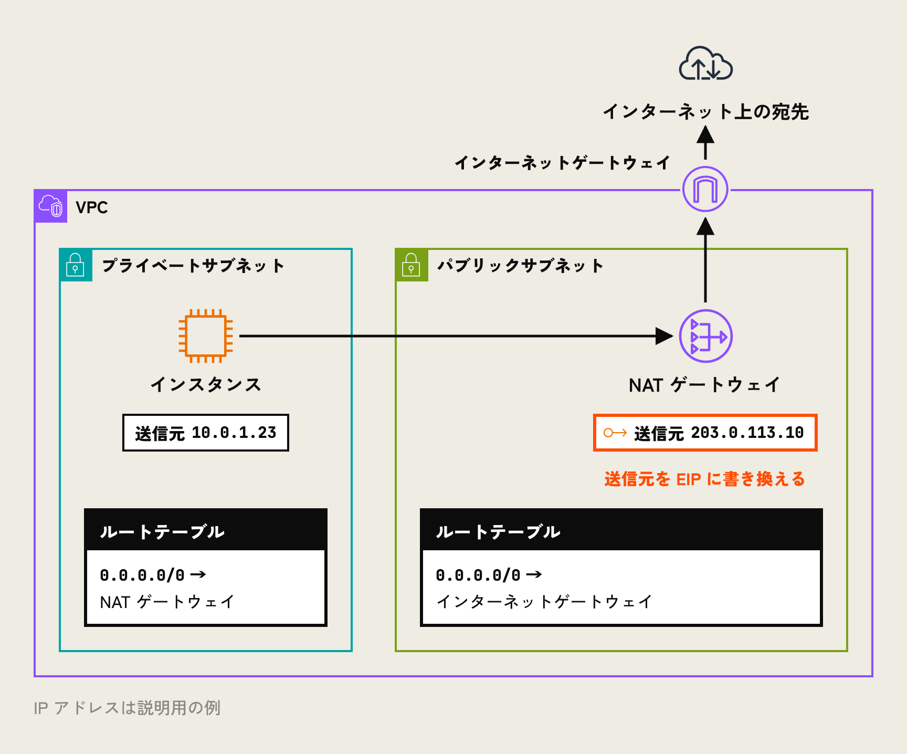
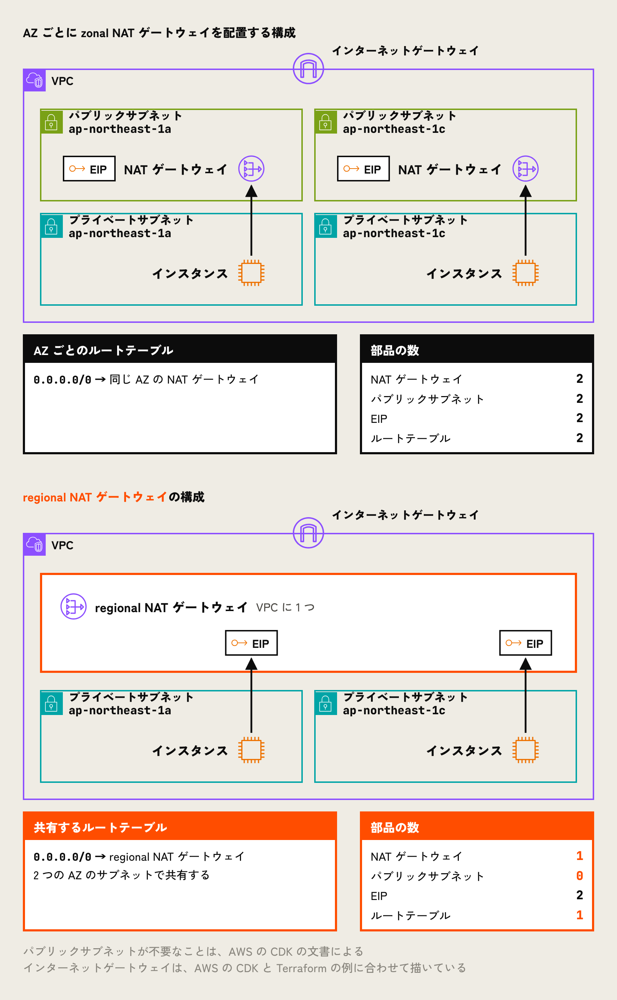
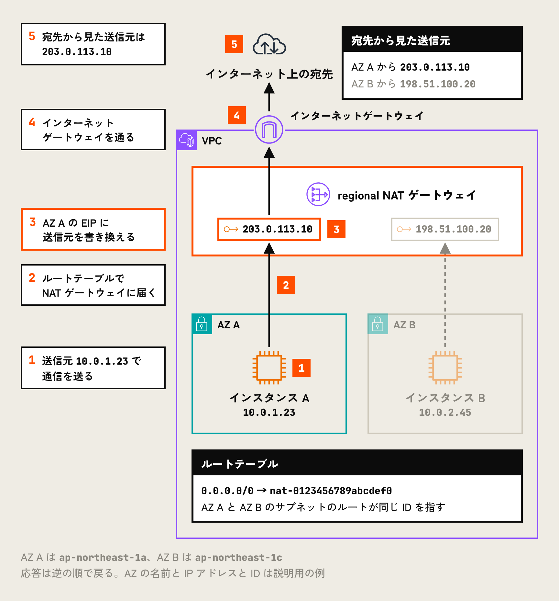
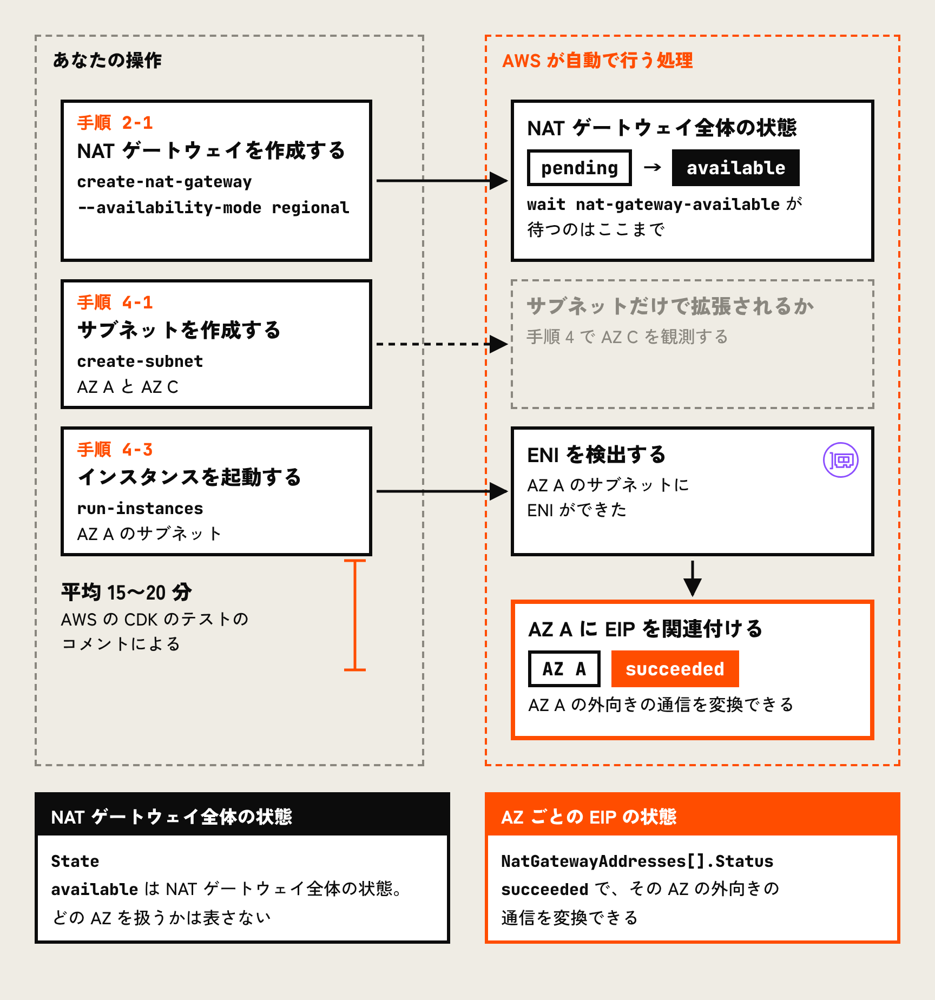
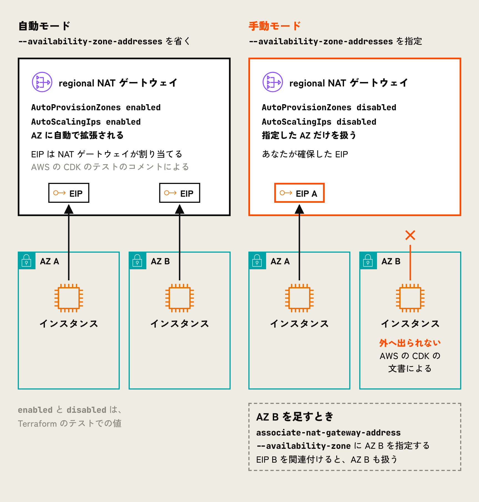
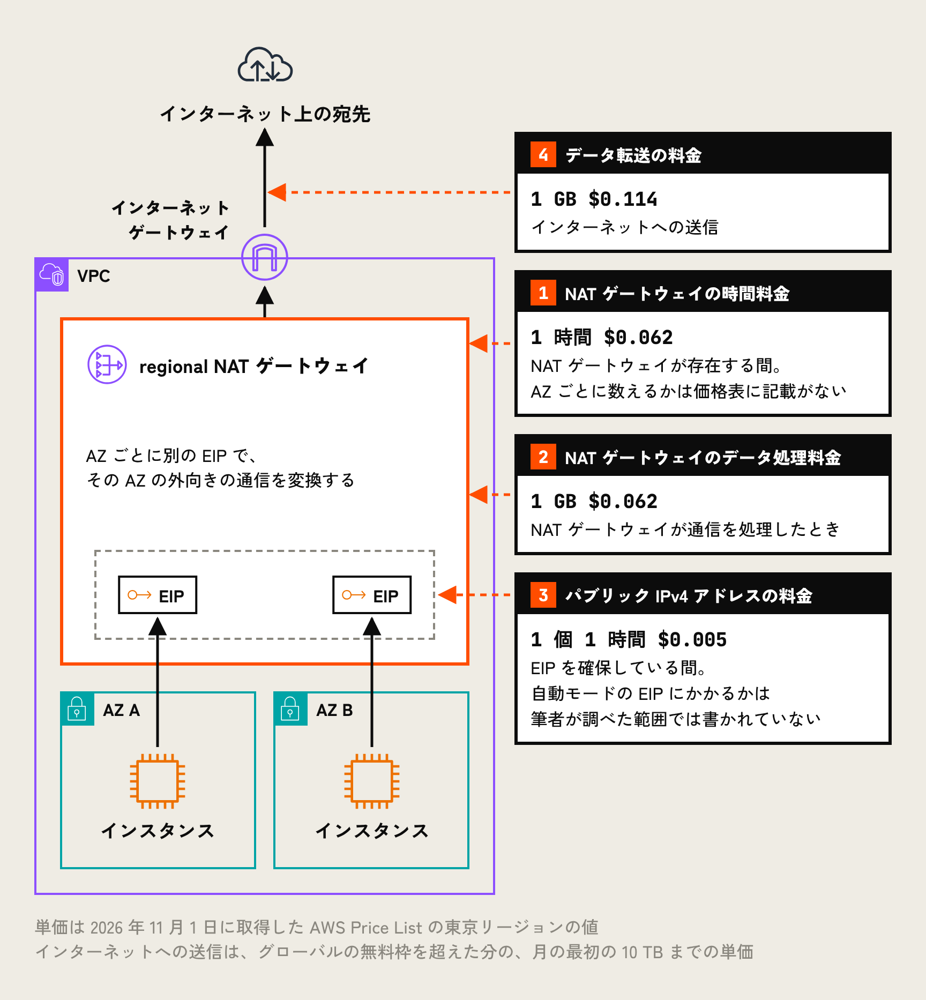
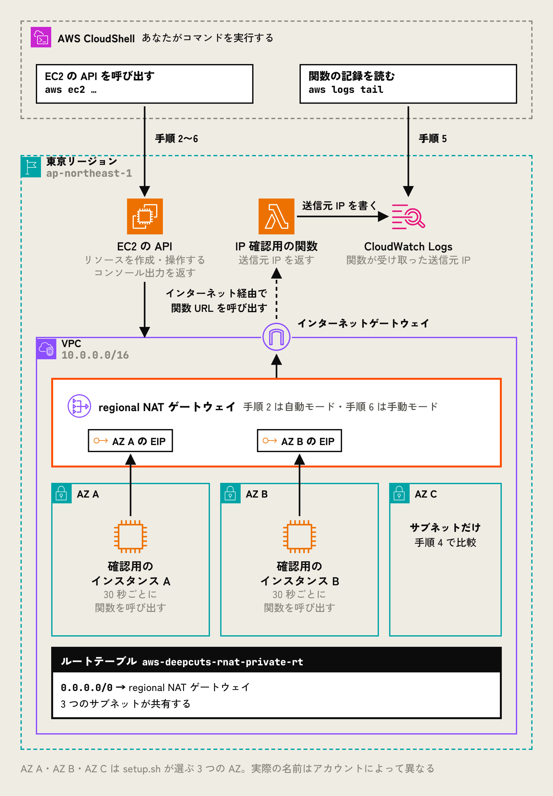

:::note info
AWS Deep Cuts の GitHub はこちらです。
https://github.com/AWS-Deep-Cuts/AWS-Deep-Cuts
:::

# AWS Deep Cutsとは？
AWS Deep Cutsは、AWS の最新のサービスやニッチな機能、または高度にアカデミックな知識を要求するサービスなど、多くの人が知らない 『隠れた名曲 = **Deep Cuts**』 を深くまで掘り下げる技術シリーズです。

このようなサービスはWeb情報も少なく、初学者は気軽にキャッチアップできないのが実情です。

そこで AWS Deep Cuts シリーズでは、**前提知識も含めた分かりやすいサービス解説** と **手順通りに進めれば誰でも再現できるハンズオン** を提供します！

# そもそもNATゲートウェイとは？
AWS で Web アプリを構築するとき、アプリのサーバーやデータベースは、インターネットから直接アクセスできないサブネットに配置するのが一般的です。ところが、そのようなサブネットに起動した EC2 インスタンスで `sudo dnf install` を実行すると、パッケージのダウンロードが始まらないまま、しばらくしてタイムアウトすることがあります。このインスタンスには、インターネットへの経路が無いためです。

VPC の中の通信をどこへ送るかは、サブネットに関連付けた**ルートテーブル**で決まります。ルートテーブルは、宛先の IP アドレスの範囲ごとに送り先を書いた表で、その 1 行を**ルート**と呼びます。VPC からインターネットへ通信するには、VPC とインターネットの間で通信を通す**インターネットゲートウェイ**を VPC に取り付け、ルートテーブルに「すべての宛先はインターネットゲートウェイへ送る」というルートを書きます。すべての宛先を表す `0.0.0.0/0` へのルートを、**デフォルトルート**と呼びます。インターネットゲートウェイへのルートを持つサブネットを**パブリックサブネット**、持たないサブネットを**プライベートサブネット**と呼びます。冒頭のインスタンスは、プライベートサブネットにあったため、インターネットへ通信できませんでした。

プライベートサブネットのインスタンスから、インターネットへ向かう通信を送るときに使うのが、**NAT ゲートウェイ**です。以降、VPC の中からインターネットへ向かう通信を、**外向きの通信**と呼びます。NAT（Network Address Translation）は、通信の送信元の IP アドレスを書き換える処理です。NAT ゲートウェイは、インスタンスから受け取った通信の送信元を、自分のパブリック IPv4 アドレスに書き換えて、インターネットゲートウェイへ送ります。このパブリック IPv4 アドレスには、**Elastic IP アドレス（EIP）** を使います。EIP は、AWS アカウントに確保して、リソースに関連付けるパブリック IPv4 アドレスです。

NAT ゲートウェイを使う構成は、次の図のとおりです。図で注目してほしいのは、通信の送信元が書き換わる場所です。



図の左のプライベートサブネットのインスタンスは、送信元をプライベート IP アドレスの `10.0.1.23` として通信を送ります。プライベートサブネットのルートテーブルには「`0.0.0.0/0` は NAT ゲートウェイへ送る」というルートが書かれているため、この通信は、右のパブリックサブネットに配置した NAT ゲートウェイに届きます。NAT ゲートウェイは、送信元を EIP の `203.0.113.10` に書き換えて、通信をインターネットゲートウェイへ送ります。そのため、宛先から見た送信元は `203.0.113.10` になります。このように、宛先から見た通信の送信元の IP アドレスを、**送信元 IP** と呼びます。図の IP アドレスは説明用の例です。

ここで、NAT ゲートウェイがどこで動いているのかを確認します。AWS のリージョンは、複数の **AZ（アベイラビリティーゾーン）** に分かれています。AZ は、リージョンの中の、互いに独立したデータセンターの集まりです。サブネットは、1 つの AZ の中に作成するものです。これまでの NAT ゲートウェイは、作成するときにサブネットを 1 つ指定する必要がありました。そのため、NAT ゲートウェイは、指定したサブネットのある 1 つの AZ で動きます。EC2 の API の説明によると、このような NAT ゲートウェイは「1 つの AZ の中で冗長性とスケーラビリティを提供する」ものです。

そこで、システムを複数の AZ に分けて動かすときは、AZ ごとに NAT ゲートウェイを配置するのが定石です。AWS が AI エージェント向けに公開している文書である **Agent Skill** のうち、本番向けの VPC を作成するものも、高可用性のためにパブリックサブネットごとに NAT ゲートウェイを作成し、各プライベートサブネットのルートテーブルを対応する NAT ゲートウェイに向けるよう指示しています。

この定石では、AZ ごとに、パブリックサブネット・NAT ゲートウェイ・EIP・ルートテーブルの 4 つをそろえます。後からシステムに AZ を足すときも、この 4 つを作り足します。

一方で、NAT ゲートウェイには、存在する時間に応じた料金と、処理したデータの量に応じた料金がかかります。AWS の価格表である AWS Price List でも、時間料金の単価は「NAT ゲートウェイ 1 時間あたり」と書かれており、NAT ゲートウェイの数だけ時間料金がかかります。そのため、NAT ゲートウェイを 1 つの AZ にだけ配置し、他の AZ のプライベートサブネットからもそれを使う構成もとられます。Lambda 関数を VPC に接続してインターネットへ通信できるようにする Agent Skill も、NAT ゲートウェイを配置する AZ を 1 つ決めるよう書いています。ただし、この構成では、NAT ゲートウェイを配置した AZ に障害が起きると、他の AZ のインスタンスも外向きの通信を送れなくなります。

AZ ごとに 4 つの部品をそろえて可用性を保つか、1 つの AZ にまとめて NAT ゲートウェイの数を減らすか。2025 年 11 月、この選択に関わる新しい作り方が、NAT ゲートウェイに加わりました。1 つの NAT ゲートウェイで、複数の AZ を扱う作り方です。

# Regional NAT Gatewayとは？
Regional NAT Gateway は、1 つの NAT ゲートウェイを VPC の複数の AZ にまたがって動かす、NAT ゲートウェイの新しい作り方です。AWS CLI の変更履歴によると、2025 年 11 月 19 日に公開された AWS CLI v2 の 2.32.0 で、この作り方のための引数が加わりました。

Regional NAT Gateway は、新しいサービスや、新しい種類のリソースではありません。NAT ゲートウェイには、1 つの AZ で動かすか、複数の AZ にまたがって動かすかを決める **availability mode** という設定があり、その値に `regional` が加わりました。API での名前は `AvailabilityMode` です。もう 1 つの値の `zonal` は、これまでと同じ 1 つの AZ で動く NAT ゲートウェイを表し、availability mode を指定しない場合は `zonal` になります。この記事では、availability mode が `zonal` のものを **zonal NAT ゲートウェイ**、`regional` のものを **regional NAT ゲートウェイ**と呼びます。

前の章の構成と並べると、次の図のようになります。上の段が AZ ごとに zonal NAT ゲートウェイを配置する構成、下の段が regional NAT ゲートウェイの構成です。



上の段では、NAT ゲートウェイ・パブリックサブネット・ルートテーブルが、AZ の数だけあります。

下の段では、NAT ゲートウェイは VPC に 1 つだけです。regional NAT ゲートウェイは、サブネットではなく VPC を指定して作成します。どの AZ のプライベートサブネットのルートテーブルも、デフォルトルートの送り先に、同じ NAT ゲートウェイの ID を指定します。図では 2 つの AZ のサブネットが 1 つのルートテーブルを共有していますが、AZ ごとのルートテーブルを残して、それぞれに同じ ID を指定する構成もとれます。どちらにするかは設計の選択です。また、1 つの NAT ゲートウェイの中に、AZ ごとに別の EIP があります。下の段にパブリックサブネットが無いことは、この後の特徴で説明します。

regional NAT ゲートウェイを AWS CLI で作成するコマンドは、次のとおりです。VPC の ID は説明用の例です。

```bash
aws ec2 create-nat-gateway --availability-mode regional --vpc-id vpc-0123456789abcdef0
```

zonal NAT ゲートウェイの作成で指定していた `--subnet-id` の代わりに、`--vpc-id` で VPC を指定します。`--availability-mode` を省くと、zonal NAT ゲートウェイを作成する指定になります。VPC コンソールの「NAT ゲートウェイを作成」の画面に、`--availability-mode` に当たる選択肢があるかは、ハンズオンの手順 2-0 で確かめます。

<!-- 要確認: 画面の項目名と、availability mode に regional を選んだときにサブネットの欄が VPC の欄に変わるか。ハンズオンの手順 2-0 で確かめ、選択肢があれば「画面にも選択肢があります」と言い切って画面の項目名を本文に書く。画面に availability mode の選択肢が無ければ、この 1 文を削る（ファクトシートの確認リスト 3） -->

この記事では、AWS CDK（AWS Cloud Development Kit）と Terraform の文書やテストも、出典に使います。AWS CDK は、プログラムのコードで AWS のリソースを定義するための、AWS の公式のライブラリです。Terraform は、設定ファイルに書いた構成に従って、AWS のリソースを作成するツールです。

regional NAT ゲートウェイには、以下のような特徴があります。

- **VPC に 1 つで複数の AZ の外向きの通信を扱う**
  EC2 の API の説明によると、regional NAT ゲートウェイは「VPC の複数の AZ にまたがって動き、リージョンのすべての AZ で冗長性・スケーラビリティ・可用性を提供する」1 つの NAT ゲートウェイです。AZ ごとに NAT ゲートウェイを作成する必要はありません。
- **パブリックサブネットを必要としない**
  AWS の CDK の文書によると、regional NAT ゲートウェイは zonal NAT ゲートウェイとは異なり、パブリックサブネットを必要とせず、VPC の単位で作成されます。ただし、AWS の CDK も Terraform も、regional NAT ゲートウェイを作成する前にインターネットゲートウェイを VPC に取り付けています。
  <!-- 要確認: インターネットゲートウェイが無い VPC で regional NAT ゲートウェイが失敗するか（ファクトシートの確認リスト 4、rng-040）。ユーザーガイドで確かめられたら書き換える -->
- **AZ ごとに別の EIP で外へ出る**
  EC2 の API の説明によると、regional NAT ゲートウェイは、AZ ごとに別の EIP を使って、その AZ からの外向きの通信を変換します。そのため、送信元 IP は AZ ごとに異なります。
- **自動モードと手動モードがある**
  NAT ゲートウェイが、ある AZ に EIP を関連付けて、その AZ の外向きの通信を変換できるようになることを、この記事では **AZ への拡張**と呼びます。作成するときに `--availability-zone-addresses` を省くと、EIP を指定せずに NAT ゲートウェイが作成され、NAT ゲートウェイは AZ に自動で拡張されます。この作り方を**自動モード**と呼びます。何をきっかけに拡張されるのかは、仕組みの章で説明します。一方、`--availability-zone-addresses` で AZ と EIP を指定すると、自動の拡張は行われず、NAT ゲートウェイは指定した AZ と EIP を使います。この作り方を**手動モード**と呼びます。この 2 つは、Terraform と AWS の CDK での呼び名で、API の用語ではありません。
- **同時接続が増えると EIP を自動で追加する**
  NAT ゲートウェイの 1 つの IP アドレスから 1 つの宛先へ同時に張れる接続の数には、上限があります。EC2 の API の説明によると、1 つの宛先への同時接続が増えると、NAT ゲートウェイは、変換に使う**ポート**が足りなくなります。ポートは、NAT ゲートウェイが変換した接続を区別するための番号です。AWS CLI の変更履歴によると、2023 年 1 月から、NAT ゲートウェイに IP アドレスを最大 8 個関連付けて、この上限を 55,000 から 440,000 に増やせるようになりました。regional NAT ゲートウェイは、この EIP の追加を自動で行うことがあります。EC2 の API の説明によると、応答の `AutoScalingIps` が `enabled` の NAT ゲートウェイは、ある AZ から 1 つの宛先への同時接続が増えると、その AZ に EIP を自動で追加します。Terraform のテストでは、自動モードで作成した NAT ゲートウェイの `AutoScalingIps` は `enabled` になります。
- **availability mode は作成後に変えられない**
  EC2 の API には、作成した NAT ゲートウェイの availability mode を変える操作がありません。CloudFormation でも、`AvailabilityMode` は作成時にだけ指定できるプロパティです。自動モードと手動モードを切り替える専用の API も無く、Terraform は、2 つのモードを切り替えると NAT ゲートウェイを作り直します。ただし、手動モードの NAT ゲートウェイに AZ を足す操作はあります。この操作は、仕組みの章で説明します。
- **単価は zonal NAT ゲートウェイと同じ**
  AWS Price List によると、東京リージョンの regional NAT ゲートウェイの単価は 1 時間 $0.062、処理したデータ 1 GB あたり $0.062 で、zonal NAT ゲートウェイと同じです。Price List に単価が載っている他のリージョンでも、regional と zonal の単価は同じです。1 時間の料金の数え方は、仕組みの章の料金の節で説明します。
- **東京リージョンにも単価が設定されている**
  <!-- 要確認: 公式の提供リージョンの一覧（rng-018）。著者が実機かユーザーガイドで確かめた後に、見出しを「東京リージョンで使える」に変え、本文を「東京で提供されています」にする -->
  AWS Price List では、東京と大阪を含む 34 のリージョンのすべてに、regional NAT ゲートウェイの単価が載っています。この 34 のリージョンに、GovCloud と中国のリージョンは含みません。

:::note info
**この記事で扱う範囲**
2026 年 10 月 22 日の AWS CLI の変更履歴には、Transit Gateway と Cloud WAN のアタッチメントに 1 対 1 の NAT を設定する機能が、「Regional Private NAT Gateway との統合」として載っています。この機能の設定の API には、NAT ゲートウェイの ID を渡す引数がありません。そのため、この機能は、この記事で扱う、VPC に作成する regional NAT ゲートウェイとは別のものです。

また、NAT ゲートウェイには、接続の種類を表す `ConnectivityType` として `public` と `private` があります。この記事で扱うのは、インターネットへ通信するための `public` の regional NAT ゲートウェイです。Terraform の文書は、regional NAT ゲートウェイの接続の種類は `public` でなければならないと書き、AWS の CDK も、regional NAT ゲートウェイには常に `public` を指定しています。
:::

# 仕組み
前の章の図に沿って、1 つの通信が regional NAT ゲートウェイを通るときに何が起きるのか、NAT ゲートウェイがどのように AZ に拡張されるのかを、順に説明します。各節で説明することと、主な API は、次のとおりです。

| 節 | 主な API | 説明すること |
| --- | --- | --- |
| 1 回の通信で起きること | `CreateRoute`・`DescribeNatGateways` | ルートテーブルと、AZ ごとの EIP による送信元の書き換え |
| 自動モードで AZ に拡張されるまで | `CreateNatGateway`・`DescribeNatGateways` | 拡張のきっかけ、かかる時間、`available` の意味 |
| 手動モード | `CreateNatGateway`・`AssociateNatGatewayAddress`・`DisassociateNatGatewayAddress` | AZ と EIP の指定と、指定していない AZ |
| 料金 | なし | 料金の要素と単価 |

この章の図は、料金の図を除いてハンズオンと共通のため、図では NAT ゲートウェイを操作する人を「あなた」と書いています。

## 1 回の通信で起きること
AZ A のインスタンスが、インターネット上の宛先へ通信を送るときの流れは、次の図のとおりです。図の AZ A は `ap-northeast-1a`、AZ B は `ap-northeast-1c` で、AZ の名前と IP アドレスと ID は説明用の例です。



図の番号の順に、何が起きるのかを説明します。

1. AZ A のインスタンスが、送信元をプライベート IP アドレスの `10.0.1.23` として、通信を送ります。
2. サブネットのルートテーブルの `0.0.0.0/0` のルートが NAT ゲートウェイの ID を指しているため、通信は NAT ゲートウェイに届きます。regional NAT ゲートウェイでは、どの AZ のサブネットのルートも、同じ ID を指します。
3. NAT ゲートウェイが、送信元を AZ A の EIP の `203.0.113.10` に書き換えます。前の章で説明したとおり、regional NAT ゲートウェイは、AZ ごとに別の EIP を使って、その AZ からの外向きの通信を変換します。
4. 通信は、インターネットゲートウェイを通って宛先に届きます。
5. 宛先から見た送信元 IP は `203.0.113.10` です。同じ時刻に AZ B のインスタンスが送った通信の送信元 IP は、AZ B の EIP の `198.51.100.20` になります。

AZ ごとの EIP は、NAT ゲートウェイの情報を返す `DescribeNatGateways` API の応答で確認できます。次の JSON は、API の仕様の項目をもとに作成した説明用の例で、一部の項目を省略しています。

```json
{
  "NatGatewayId": "nat-0123456789abcdef0",
  "VpcId": "vpc-0123456789abcdef0",
  "State": "available",
  "AvailabilityMode": "regional",
  "AutoProvisionZones": "enabled",
  "AutoScalingIps": "enabled",
  "NatGatewayAddresses": [
    { "AvailabilityZone": "ap-northeast-1a", "PublicIp": "203.0.113.10", "Status": "succeeded" },
    { "AvailabilityZone": "ap-northeast-1c", "PublicIp": "198.51.100.20", "Status": "succeeded" }
  ]
}
```

主なキーの意味は、次のとおりです。`State` は次の節で説明します。

| キー | 意味 |
| --- | --- |
| `AvailabilityMode` | availability mode。`zonal` か `regional` のどちらか |
| `AutoProvisionZones` | `enabled` のとき、NAT ゲートウェイは AZ に自動で拡張される |
| `AutoScalingIps` | `enabled` のとき、ある AZ から 1 つの宛先への同時接続が増えると、NAT ゲートウェイがその AZ に EIP を自動で追加する |
| `NatGatewayAddresses` | NAT ゲートウェイが使っている EIP の一覧。各要素に、その EIP を使っている AZ の `AvailabilityZone`、EIP の `PublicIp`、その EIP の状態を表す `Status` が入る |

`AutoProvisionZones` と `AutoScalingIps` は、応答にだけある読み取り専用の項目で、作成するときに指定する引数はありません。Terraform のテストでは、自動モードで作成すると両方が `enabled` に、手動モードで作成すると両方が `disabled` になります。また、実際の応答の `NatGatewayAddresses` の各要素には、`AvailabilityZoneId` や `AllocationId` などの項目も入ります。

`NatGatewayAddresses` に `Status` が `succeeded` の要素がある AZ では、その要素の EIP で外向きの通信が変換されます。この AZ を、NAT ゲートウェイが**扱う AZ** と呼びます。

このように、regional NAT ゲートウェイでは、送信元 IP が AZ ごとに異なります。このことは、外部のサービスに送信元 IP を登録して、アクセスを許可してもらうときに問題になります。この問題への対処は、手動モードの節とベストプラクティスの章で説明します。

## 自動モードで AZ に拡張されるまで
自動モードの regional NAT ゲートウェイは、作成した直後から VPC のすべての AZ を扱うとは限りません。新しい AZ でインスタンスを使い始めた直後には、NAT ゲートウェイがその AZ をまだ扱っていないことがあります。

次の図は、あなたの操作と、AWS が自動で行う処理を、時間の順に上から並べたものです。



まず、何をきっかけに拡張されるのかを説明します。EC2 インスタンスなどを VPC に接続するときに、サブネットの中に作成される仮想的なネットワークインターフェイスを、**ENI（Elastic Network Interface）** と呼びます。EC2 の API の `CreateNatGateway` の説明によると、自動モードの NAT ゲートウェイは「ENI を検出したときに、新しい AZ に拡張して EIP を関連付ける」ものです。AWS の CDK のテストのコメントも、自動モードは「ENI を検出して初めて AZ に拡張する」と書いています。図の右の列の「ENI を検出する」から「AZ A に EIP を関連付ける」への流れが、この説明に当たります。

一方、応答の `AutoProvisionZones` の説明には、NAT ゲートウェイは「VPC にサブネットがあるすべての AZ で EIP を関連付け、新しい AZ にサブネットを作成するとその AZ に拡張する」と書かれています。つまり、API の説明の中で、拡張のきっかけが ENI なのかサブネットなのか、書き方が分かれています。図の右の列の灰色の点線の箱「サブネットだけで拡張されるか」は、この点を表しています。ハンズオンの手順 4 では、インスタンスのある AZ と、サブネットだけを作成した AZ を並べて、どちらで拡張されるのかを観測します。

次に、拡張にかかる時間です。AWS の CDK のテストのコメントによると、AWS の文書には、拡張に平均 15〜20 分かかると書かれています。このテストは、自動モードの NAT ゲートウェイを通る通信が成功するまで、最大 30 分待つように作られています。図の左の「平均 15〜20 分」の区間線は、この時間を示したものです。ただし、コメントには、この時間をどの時点から数えるのかは書かれていないため、図の区間線の始まりも目安です。

<!-- 要確認: ユーザーガイド（rng-003）で拡張の時間の記述を確かめる。確かめられたら「ユーザーガイドによると」に変える。最大値は書かない（rng-059） -->

拡張を待つときに注意が必要なのが、NAT ゲートウェイ全体の状態です。NAT ゲートウェイ全体の状態は、応答の `State` で表され、値は `pending`・`failed`・`available`・`deleting`・`deleted` のいずれかです。EC2 の API の説明によると、`available` は NAT ゲートウェイが通信を処理できる状態で、削除するまで変わらず、NAT ゲートウェイの健全性を表すものではありません。つまり、`State` が `available` になっても、すべての AZ に拡張されたとは限りません。

AWS CLI の `aws ec2 wait` コマンドは、リソースの状態が変わるまで、API を繰り返し呼び出して待つコマンドです。このうち `aws ec2 wait nat-gateway-available` は、NAT ゲートウェイ全体の `State` だけを、15 秒おきに最大 40 回、つまり最大 10 分確認します。AZ ごとの EIP の状態は確認しません。図の右の列のいちばん上の「NAT ゲートウェイ全体の状態」の箱が示すように、このコマンドが待つのは、`State` が `available` になるまでです。そのため、ある AZ に拡張されたかどうかは、`NatGatewayAddresses` にその AZ の要素が現れ、その `Status` が `succeeded` になったかで確かめます。

拡張が終わるまでの間に、その AZ のインスタンスの外向きの通信がどう扱われるのかは、筆者が調べた範囲の公式の情報では説明が見つかりませんでした。この点は、ハンズオンの手順 5 で実際に観測します。

なお、`AutoProvisionZones` の説明によると、NAT ゲートウェイは、サブネットをすべて削除した AZ からは縮小し、その AZ を扱わなくなります。

## 手動モード
外部のサービスに送信元 IP を登録している場合のように、すべての AZ の送信元 IP を自分で決めたいときに確実なのが、手動モードです。AWS の CDK のテストのコメントによると、自動モードでは、NAT ゲートウェイが使うアドレスを NAT ゲートウェイ自身が割り当てます。また、前の章で説明したとおり、同時接続が増えると EIP を自動で追加します。

自動モードと手動モードの違いは、次の図のとおりです。



手動モードでは、あなたが確保した EIP を使います。EIP を確保すると、`eipalloc-` で始まる**割り当て ID** が発行されます。手動モードの NAT ゲートウェイを作成するときは、`--availability-zone-addresses` に、AZ と、その AZ で使う EIP の割り当て ID の一覧を渡します。次のコマンドは、AZ `ap-northeast-1a` に 1 つの EIP を指定する例です。ID は説明用の例です。

```bash
aws ec2 create-nat-gateway --availability-mode regional --vpc-id vpc-0123456789abcdef0 \
  --availability-zone-addresses '[{"AvailabilityZone": "ap-northeast-1a", "AllocationIds": ["eipalloc-0123456789abcdef0"]}]'
```

AZ は、`ap-northeast-1a` のような AZ の名前の代わりに、`apne1-az1` のような **AZ ID** でも指定できます。EC2 の API の説明によると、AZ ID は、AZ を一貫して識別するために、AZ の名前の代わりに使うものです。

手動モードの NAT ゲートウェイは、指定した AZ だけを扱います。EC2 の API の説明によると、手動モードでは自動の拡張が行われず、どの AZ を扱うかを自分で管理する必要があります。さらに、AWS の CDK の文書は、指定していない AZ のサブネットからのデフォルトルートは「実行時に通信を通さない」と書いています。図の右の列の AZ B が、この状態です。AWS の CDK は、このような構成をエラーとして扱います。また、AWS の CDK のテストのコメントによると、手動モードの NAT ゲートウェイは、作成した時点から指定した AZ を扱います。自動モードのように、AZ に拡張されるのを待つ必要はありません。

手動モードの NAT ゲートウェイに AZ を足すときは、`AssociateNatGatewayAddress` API に、AZ と EIP の割り当て ID を指定して、EIP を関連付けます。図の右下の箱が、この操作です。EIP を NAT ゲートウェイに関連付けると、`eipassoc-` で始まる**関連付け ID** が発行されます。AZ を外すときは、`DisassociateNatGatewayAddress` API に、割り当て ID ではなく、この関連付け ID を指定します。関連付け ID は、`DescribeNatGateways` の応答の `NatGatewayAddresses` の各要素の `AssociationId` で確認できます。

EC2 の API の説明によると、`DisassociateNatGatewayAddress` で外した EIP は、すぐには NAT ゲートウェイから外れません。外した EIP は、既存の接続を引き続き扱い、新しい接続は扱わない状態で、`MaxDrainDurationSeconds` の秒数が過ぎるまで関連付けられたままになります。この秒数は 1〜4,000 秒の範囲で指定でき、CloudFormation のスキーマによると既定は 350 秒です。また、Terraform の文書によると、1 回の変更で EIP を別の AZ へ移すことはできません。

:::note info
**手動モードと EIP の自動追加**
Terraform のテストでは、手動モードで作成した NAT ゲートウェイの `AutoScalingIps` は `disabled` になります。このことから、手動モードでは、同時接続が増えたときの EIP の自動追加も行われないと考えられます。
:::

前の章で説明したとおり、自動モードと手動モードを切り替える専用の API はありません。そこで筆者は、モードを確実に切り替えるには、新しい NAT ゲートウェイを作成し、プライベートサブネットのルートの送り先を付け替えるのがよいと考えます。ハンズオンの手順 6 でも、この方法で自動モードから手動モードに切り替えます。

## 料金
最後に、ここまでに出てきた部品に、どのような料金がかかるのかを説明します。単価は、2026 年 11 月 1 日に取得した AWS Price List の、東京リージョンの値です。

| 料金の要素 | かかるとき | 東京リージョンの単価 |
| --- | --- | --- |
| ① NAT ゲートウェイの時間料金 | NAT ゲートウェイが存在する間 | 1 時間 $0.062。zonal NAT ゲートウェイと同じ |
| ② NAT ゲートウェイのデータ処理料金 | NAT ゲートウェイが通信を処理したとき | 1 GB $0.062。zonal NAT ゲートウェイと同じ |
| ③ パブリック IPv4 アドレスの料金 | EIP を確保している間。EIP を使っているかどうかに関係なくかかる | 1 個 1 時間 $0.005 |
| ④ データ転送の料金 | インターネットへ送信したとき、AZ をまたいで通信したとき | インターネットへの送信は 1 GB $0.114。グローバルの無料枠を超えた分の、月の最初の 10 TB までの単価。AZ 間の転送は 1 GB $0.01 |

次の図は、4 つの料金が、構成のどこでかかるのかを示しています。図の札の 1〜4 は、表の ①〜④ に対応します。



注意が必要なのは、① の時間料金の数え方です。AWS Price List の regional NAT ゲートウェイの時間料金の説明は、「Regional NAT Gateway の 1 時間あたりの料金」だけで、扱う AZ の数を掛けるかどうかは書かれていません。そのため、regional NAT ゲートウェイが、AZ ごとに zonal NAT ゲートウェイを配置する構成と比べて安くなるかどうかは、価格表からは判断できません。

<!-- 要確認: 料金ページ（https://aws.amazon.com/vpc/pricing/）で regional の時間料金の数え方を確かめ、確かめられたら本文を書き換える（rng-071） -->

この数え方は、実際の請求で確かめられます。AWS の料金を項目ごとに確認できる Cost Explorer では、料金の項目を**使用タイプ**という名前で区別します。Agent Skill によると、NAT ゲートウェイの料金は、Cost Explorer のサービス「EC2 - Other」に含まれます。東京リージョンの regional NAT ゲートウェイの時間料金の使用タイプは、`APN1-RegionalNatGateway-Hours` です。ハンズオンの手順 8 では、翌日以降に Cost Explorer でこの使用タイプの使用量を確認し、時間料金がどう数えられたかを確かめます。

③ のパブリック IPv4 アドレスの料金は、EIP の数だけかかります。regional NAT ゲートウェイは AZ ごとに EIP を使うため、手動モードで自分で確保した EIP には、少なくとも扱う AZ の数だけ、この料金がかかります。一方、自動モードで割り当てられる EIP にこの料金がかかるかどうかは、筆者が調べた範囲の情報には書かれていませんでした。ハンズオンの手順 5 と手順 6 では、その EIP が、自分のアカウントの EIP として表示されるかを観測します。

なお、AWS Price List には、NAT ゲートウェイの無料利用枠に当たる単価はありません。

# Regional NAT Gatewayの主な活用事例
ここまでで、regional NAT ゲートウェイが、VPC に 1 つで複数の AZ の外向きの通信を扱えることを見てきました。この特徴を生かせる場面を、AWS の公式の情報をもとに筆者が整理しました。

- **複数の AZ に分けたシステムの外向きの通信を 1 つにまとめる**
  AZ ごとのパブリックサブネット・NAT ゲートウェイ・ルートテーブルを用意せずに、すべての AZ のプライベートサブネットから、1 つの NAT ゲートウェイを通して外向きの通信を送れます。AWS の CDK も、regional NAT ゲートウェイを選ぶと、作成する NAT ゲートウェイの数の指定を無視し、1 つの NAT ゲートウェイですべての AZ を扱います。
- **後から AZ を足す構成**
  AWS が公開している Amazon EKS のサンプルには、後からプライベートサブネットを追加する例があります。GPU の容量を予約した AZ が、最初に VPC を作成したときの AZ に含まれていない場合に、その AZ にプライベートサブネットを追加し、同じ regional NAT ゲートウェイを通します。AZ を足しても、NAT ゲートウェイを作り足す必要はありません。ただし、自動モードでは、仕組みの章で説明したとおり、新しい AZ に拡張されるまでに時間がかかります。
- **送信元 IP を相手先に登録する連携**
  手動モードで、自分で確保した EIP を AZ ごとに指定すれば、相手先に登録する送信元 IP を自分で決められます。
- **1 つの宛先へ大量の同時接続を送る処理**
  ある AZ から 1 つの宛先への同時接続が増えると、自動モードの NAT ゲートウェイは、その AZ に EIP を自動で追加します。ただし、EIP が増えると送信元 IP も増えるため、送信元 IP を相手先に登録する連携とは両立しにくくなります。

# Regional NAT Gatewayを使う際のベストプラクティス
ここまでの仕組みを踏まえて、regional NAT ゲートウェイを使うときに守りたいことを挙げます。公式の情報に基づく部分には出典を書き、筆者の考えには「筆者は」と書いています。

- **新しい AZ を使い始める前にその AZ に拡張されたことを確かめる**
  `NatGatewayAddresses` に、その AZ の要素が `Status` が `succeeded` の状態で現れたかを確かめます。NAT ゲートウェイ全体の `State` が `available` であることや、`aws ec2 wait nat-gateway-available` が終わったことだけで判断しません。すぐに使いたい AZ が決まっているなら、作成した時点から指定した AZ を扱う手動モードも選べます。
- **送信元 IP を相手先に登録するなら手動モードを使う**
  AWS の CDK のテストのコメントによると、自動モードでは、NAT ゲートウェイが使うアドレスを NAT ゲートウェイ自身が割り当てます。また、自動モードの NAT ゲートウェイは、同時接続が増えると EIP を追加します。すべての AZ の送信元 IP を自分で決めるには、手動モードで、自分の EIP をすべての AZ に指定し、相手先にはすべての AZ の EIP を登録するのが確実です。なお、自動モードで EIP を指定できるかどうかは、出典によって書き方が異なります。Terraform の文書は、regional NAT ゲートウェイでは `allocation_id` を指定してはならないと書いていますが、AWS の CDK は、自動モードに EIP を 1 つ渡す使い方を用意しています。
- **手動モードではルートを向けるすべての AZ を指定する**
  指定していない AZ のサブネットからは、外向きの通信を送れません。手動モードの NAT ゲートウェイを使う VPC に AZ を足すときは、筆者は、その AZ にサブネットを作成する前に、`AssociateNatGatewayAddress` でその AZ に EIP を関連付けることを勧めます。
- **削除するときは EIP とルートも片付ける**
  EC2 の API の説明によると、NAT ゲートウェイを削除しても、EIP はアカウントから解放されず、ルートテーブルの NAT ゲートウェイへのルートも削除されません。解放し忘れた EIP には、使っていなくてもパブリック IPv4 アドレスの料金がかかります。NAT ゲートウェイを削除した後に、自分で確保した EIP を解放し、不要になったルートも削除します。
- **IaC の対応を確かめる**
  IaC（Infrastructure as Code）は、AWS のリソースの構成をコードで定義し、コードからリソースを作成する方法です。Terraform で AWS を扱うための Terraform AWS Provider は、2025 年 12 月 2 日の 6.24.0 で regional NAT ゲートウェイに対応しました。AWS の CDK は、2026 年 9 月 30 日の v2.272.0 で、regional NAT ゲートウェイを作成する `NatProvider.regionalGateway()` を加えました。一方、Terraform で VPC を作成するときに広く使われているモジュールの terraform-aws-modules/vpc は、2026 年 11 月 1 日の時点で regional NAT ゲートウェイに対応していません。また、Terraform では、自動モードと手動モードを切り替えると、NAT ゲートウェイが作り直されます。
- **zonal から移るときは新しく作成してルートを付け替える**
  zonal NAT ゲートウェイを regional NAT ゲートウェイに変える API はありません。筆者は、新しく regional NAT ゲートウェイを作成し、プライベートサブネットのルートの送り先を付け替える方法を勧めます。zonal NAT ゲートウェイを削除しても、EIP はアカウントに残ります。そのため、これまで各 AZ で使っていた EIP を、手動モードで同じ AZ に指定すれば、送信元 IP を変えずに移れると考えられます。ただし、1 つの AZ にだけ NAT ゲートウェイを配置していた場合は、regional NAT ゲートウェイに移ると、相手先に登録する送信元 IP が AZ の数に増えます。
  <!-- 要確認: ユーザーガイドに zonal から regional への移行の手順があれば、それに合わせる。切り替えの間に既存の接続が切れるかも確かめる（rng-086） -->

# ハンズオンはこちら！
ハンズオンでは、パブリックサブネットの無い VPC に regional NAT ゲートウェイを作成し、2 つの AZ のインスタンスから外へ出る通信の送信元 IP を観測します。サブネットだけを作成した AZ と比べながら、NAT ゲートウェイが AZ に拡張されるまでの時間を測り、手動モードで送信元 IP を自分の EIP に変えるところまで、AWS CLI のコマンドを 1 つずつ実行して確かめます。

送信元 IP は、あなたのアカウントに作成する、呼び出し元の送信元 IP を返す Lambda 関数で調べます。この関数を、**IP 確認用の関数**と呼びます。AWS の CDK のテストも、同じ方法で、regional NAT ゲートウェイを通った通信の送信元 IP を確かめています。

ハンズオンの構成は、次の図のとおりです。図の「手順 2」などの番号は、ハンズオンの手順の番号です。



https://github.com/AWS-Deep-Cuts/aws-regional-nat-gateway

# まとめ
Regional NAT Gateway は、1 つの NAT ゲートウェイで、VPC の複数の AZ の外向きの通信を扱える、NAT ゲートウェイの新しい作り方です。冒頭の「そもそも」の章で説明した、AZ ごとに zonal NAT ゲートウェイを配置する構成と比べると、次のようになります。

| 観点 | AZ ごとの zonal NAT ゲートウェイ | regional NAT ゲートウェイ |
| --- | --- | --- |
| NAT ゲートウェイの数 | AZ の数だけ | VPC に 1 つ |
| パブリックサブネット | AZ ごとに必要 | 不要。AWS の CDK の文書による |
| インターネットゲートウェイ | 必要 | AWS の CDK と Terraform は取り付けている |
| プライベートサブネットのルート | 同じ AZ の NAT ゲートウェイに向ける | どの AZ も同じ NAT ゲートウェイに向ける |
| 送信元 IP | AZ ごとの EIP | AZ ごとの EIP。すべての AZ を自分の EIP にするなら手動モード |
| 新しい AZ を足すとき | パブリックサブネット・NAT ゲートウェイ・EIP・ルートテーブルを作り足す | 自動モードでは拡張されるのを待つ。AWS の CDK のテストのコメントによると平均 15〜20 分。手動モードでは EIP を関連付ける |
| 時間料金の単価 | 1 時間 $0.062 | 1 時間 $0.062。AZ ごとに数えるかは、価格表からは分からない |

<!-- 要確認: インターネットゲートウェイの行。regional で取り付けないと失敗するかをユーザーガイドで確かめ、確かめられたら「必要」に変える（rng-040） -->

AZ ごとに NAT ゲートウェイを配置するかどうか迷っていた方は、ぜひハンズオンで、NAT ゲートウェイが AZ に拡張される様子を観測し、翌日に時間料金の数え方まで確かめてみてください！

---

参考文献
1. [Regional NAT ゲートウェイによる複数の AZ への自動拡張（Regional NAT gateways for automatic multi-AZ expansion）](https://docs.aws.amazon.com/vpc/latest/userguide/nat-gateways-regional.html) <!-- 要確認: ページを開いて題と内容を確かめる（rng-003） -->
1. [AWS NAT Gateway がリージョン単位の可用性に対応（AWS What's New, 2025 年 11 月）](https://aws.amazon.com/about-aws/whats-new/2025/11/aws-nat-gateway-regional-availability/) <!-- 要確認: 公開前に、この What's New のページで英語の原題と日付を確かめる。日本語訳を原題の訳に合わせ、括弧の中の「AWS What's New, 2025 年 11 月」を英語の原題に置き換えて、他の参考文献と同じ「日本語訳（英語の原題）」の形にそろえる。原題は調査の記録に無いため、推測で書かない（rng-007） -->
1. [CreateNatGateway の API リファレンス（Amazon EC2 API Reference: CreateNatGateway）](https://docs.aws.amazon.com/AWSEC2/latest/APIReference/API_CreateNatGateway.html) <!-- 要確認: URL と原題 -->
1. [AWS CLI v2 の変更履歴（AWS CLI v2 CHANGELOG）](https://github.com/aws/aws-cli/blob/v2/CHANGELOG.rst)
1. [AWS Price List のサービスの一覧（AWS Price List: offer index）](https://pricing.us-east-1.amazonaws.com/offers/v1.0/aws/index.json)
1. [AWS CDK の aws-ec2 モジュールの README（aws-cdk-lib/aws-ec2 README）](https://github.com/aws/aws-cdk/blob/main/packages/aws-cdk-lib/aws-ec2/README.md)
1. [AWS CDK の Regional NAT Gateway の統合テスト（integ.regional-nat-gateway-egress.ts）](https://github.com/aws/aws-cdk/blob/main/packages/@aws-cdk-testing/framework-integ/test/aws-ec2/test/integ.regional-nat-gateway-egress.ts)
1. [本番向けのマルチ AZ の VPC を作成する Agent Skill（creating-production-vpc-multi-az）](https://github.com/aws/agent-toolkit-for-aws/blob/main/skills/specialized-skills/networking-and-content-delivery-skills/creating-production-vpc-multi-az/SKILL.md)
1. [Lambda 関数を VPC からインターネットへ接続する Agent Skill（enabling-lambda-vpc-internet-access）](https://github.com/aws/agent-toolkit-for-aws/blob/main/skills/specialized-skills/networking-and-content-delivery-skills/enabling-lambda-vpc-internet-access/SKILL.md)
1. [Cost Explorer の使い方をまとめた Agent Skill の参考資料（aws-billing-and-cost-management: cost-explorer.md）](https://github.com/aws/agent-toolkit-for-aws/blob/main/skills/core-skills/aws-billing-and-cost-management/references/cost-explorer.md)
1. [Terraform AWS Provider の aws_nat_gateway（Resource: aws_nat_gateway）](https://registry.terraform.io/providers/hashicorp/aws/latest/docs/resources/nat_gateway)
1. [Terraform の VPC モジュール（terraform-aws-modules/terraform-aws-vpc）](https://github.com/terraform-aws-modules/terraform-aws-vpc)
1. [Amazon EKS のドキュメントのサンプル（sample-eks-docs）](https://github.com/aws-samples/sample-eks-docs)
